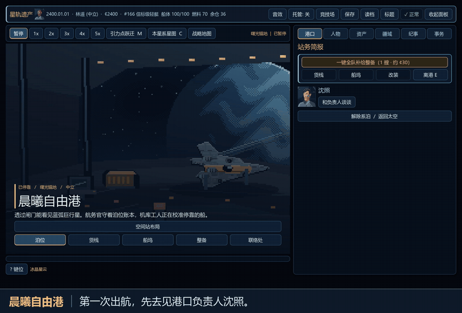

# 星轨遗产

星门熄灭两百年后，炉心转运站的熔炉正等着下一批矿石。你可以开着航务局配发的小船去跑这趟货，也可以留在港里当站长，把航线交给自己雇来的船长。

《星轨遗产》是一款中文单人太空沙盒。你亲自驾驶旗舰，也要为燃料、货物和下一艘船付钱。等这一代船长老去，子女还能接过家业，在同一个星区继续生活。

[下载 Windows 64 位试玩版（ZIP）](https://github.com/malemeng/starrail-legacy/releases/latest/download/StarrailLegacy-Windows-x64.zip) · 完整解压，保留同目录的 `fleet_collision.dll`，双击 `StarrailLegacy.exe` 即可离线游玩。

[下载安卓横屏试玩版 0.1.2（APK）](https://github.com/malemeng/starrail-legacy/releases/download/android-0.1.2/StarrailLegacy-Android.apk) · 适用于 Android 7.0 及以上的 ARM64 手机，支持触屏驾驶、外部模型托管和多 Agent 竞技场。此版修复了 Android 16 上开场环境音循环时的退出问题，已有 0.1.0 或 0.1.1 可覆盖安装。

## 实机演示

录像节选自 Windows 试玩版的一次首航。沈照托你捎 8 单位矿石，收货人罗启山在另一个星系。[观看高清实机录像（MP4）](docs/gameplay/first-voyage.mp4)

想在游戏里旁观一趟跑商，也可以双击试玩包里的 `Watch-Freight.cmd`，看商船买进矿石、交付委托，再把多带的矿石卖给当地货栈。

## 你的第一趟货运

1. **在晨曦接单。** 从「新航程」选择「舰长开局」并启航。在晨曦自由港点「和负责人谈谈」，从沈照手里接下可选委托「熄火之前」。
2. **飞往第 02 号星系。** 按 `C` 打开本星系星图，选「恒星引力点」，点「离港并导航」，按 `C` 返回飞行画面。抵达引力点后按 `M` 跃入超空间，选第 02 号星系的信标，飞到信标旁再按一次 `M`。
3. **装矿，找人交货。** 飞近小行星矿带，按 `G` 采够 8 单位矿石，也可以在当地采矿站购买。导航至炉心转运站，靠近泊位按 `E`。在联络处找罗启山，选「送来 8 单位矿石。」即可领到 ¢210。回晨曦找沈照报个平安，还有 ¢40 返航津贴。

## 下一趟去哪儿

- **做买卖。** 货栈会给整批货报价。试着把采矿站的余矿运到缺料的冶炼站。等对方的仓库装满，同一条航线的利润也会变薄。
- **带舰队出港。** 在船坞挑一艘新船，给它装上舰炮，配一名船长，让它跟随旗舰。遇敌时可以亲自瞄准开火，也可以打开战术图，让僚舰护卫你或集火同一目标。
- **留在港里经营。** 开局也能选「独立站长」或「受雇站长」。给货船安排采矿和运输，靠卖货的收入扩建港口。想接手一家公司，还可以收购股份、争取其他股东投票。
- **把驾驶交给 AI。** 在附带内置运行环境的试玩包中，点顶栏「托管」并配置自己的模型服务，就能旁观 AI 接手当前航程。「竞技场」还能让多个 AI 对战。[托管与竞技场说明](AGENT_PLAY.md)

## 常用操作

安卓试玩版以横屏运行，适用于 Android 7.0 及以上的 ARM64 设备，也支持 x86_64 模拟器。安装 `StarrailLegacy-Android.apk` 后，从「新航程」开始。在港口用触屏交易和整备，离港后点「1×」让时间流动，用左侧摇杆驾驶。选「航点」后点目的地，或选「开火」并按住战场瞄准射击。右手可同时按住护盾或助推。顶栏提供保存和读档。

安卓也支持单人模型托管和多 Agent 竞技场。选「托管」填写自己的模型服务即可启用，常规游戏可离线游玩。[安卓托管设置](AGENT_PLAY.md#安卓模型托管)

| 想做什么 | 操作 |
| --- | --- |
| 暂停或继续时间 | 空格。新航程开始时处于暂停状态 |
| 手动飞行、大范围巡航 | `W A S D` 驾驶，按住 `Ctrl` 助推，飞行时在空白处点右键设航点 |
| 查航线、进出超空间 | `C` 开关本星系星图，`M` 在引力点或目的地信标旁跃迁 |
| 离港、停靠、采集 | `E` 离港或在泊位旁停靠，`G` 采矿、打捞或勘测 |
| 操纵武器与护盾 | 鼠标瞄准，左键开火，按住 `Shift` 开盾，`Tab` 打开战术图 |
| 保存进度 | 脱离交火后按 `F5` 保存，`F9` 读取手动存档。新建航程和靠港时会自动存档 |

## 许可证

MIT 许可证仅适用于本项目贡献者原创并有权授权的源代码，包括游戏逻辑、Agent 桥接程序和构建工具。复制或分发这些代码或其中的实质性部分时，请保留版权声明和许可声明。[MIT 许可证全文](LICENSE)

游戏美术、音频、剧情文本、文档、截图、商标和舰船资料等数据，按各自权利人的单独授权使用。Godot、godot-cpp、Python、smolagents 及其他第三方组件遵循各自的许可证。
