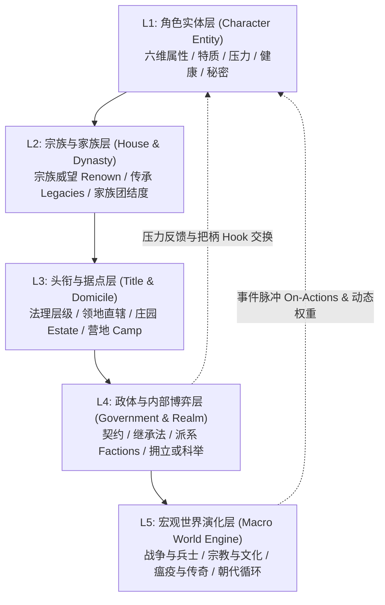

# 《十字军之王3 (Crusader Kings III)》深度系统架构与叙事博弈报告（AI Agent 专用技术规范）

> **文档定位**：本报告面向游戏 AI 研究者、多智能体系统（Multi-Agent Systems）架构师及叙事引擎开发者，采用高度结构化的数据模型、状态机、博弈矩阵与形式化规则，对《十字军之王3 (Crusader Kings III, CK3)》及其截至 **Chapter IV (2025–2026)** 的全系列核心扩展包（包含 *Royal Court*, *Tours & Tournaments*, *Legends of the Dead*, *Roads to Power*, *Wandering Nobles*, *Khans of the Steppe*, *Coronations*, *All Under Heaven*）进行底层机制拆解。

---

## 第一部分：核心玩法机制与角色驱动大战略架构

### 1. 核心设计哲学与系统耦合总览

#### 1.1 “扮演角色与家族，而非扮演国家”的底层范式
传统大战略游戏（Grand Strategy Games, GSG，如 *Europa Universalis IV* 或 *Hearts of Iron IV*）以**主权国家实体（State/Tag）**作为玩家代理的根节点，领土边界、国库与外交关系均绑定于静态国家实体。CK3 则彻底颠覆了这一范式，采用**角色-家族双核驱动架构（Character-Dynasty Dual-Core Architecture）**：

1. **代理连续性（Agency Continuity）与死亡继承**：玩家的直接控制权绑定于单个存活角色（`Player Character`）。当该角色死亡时，控制权并非终止，而是依据**继承法（Succession Laws）**转移至指定继承人（`Player Heir`）。只要继承人属于同一**宗族（Dynasty）**且满足最低生存载体条件（拥有至少一块伯爵领 `County`、或处于行政制 `Administrative` 家族庄园体系、或作为无地冒险者 `Landless Adventurer` 拥有营地 `Camp`），游戏即继续推进。
2. **失败条件（Game Over Conditions）**：
   - 玩家角色死亡时，没有同宗族的合法继承人；
   - 玩家角色失去所有领地头衔，且未处于无地冒险者或行政制庄园主（Estate Holder）状态（注：自 *Roads to Power* 起，失去全部领地的封建/氏族统治者可触发事件转化为无地冒险者，从而大幅延展了生存状态机）。
3. **非理性对齐机制（Irrationality Alignment）**：人类或理性 AI 倾向于执行“全局最优解”（如无条件暗杀多余子嗣、频繁违约扩张），但 CK3 通过**压力系统（Stress）**、**暴政值（Tyranny）**与**正统性（Legitimacy）**构建了强约束反馈环，迫使代理在“地缘最优”与“角色性格一致（In-Character）”之间进行效用权衡。

#### 1.2 五层耦合系统架构图



---

### 2. 角色数据模型与 RPG 系统

在 CK3 的内存与脚本模型中，**角色（Character）**是最核心的一等公民（First-Class Entity）。每个角色均包含一套高维属性向量与动态状态标签。

#### 2.1 六维基础属性与能力映射表
游戏内所有数值判定最终归约至五项基础治理属性与一项个人战斗属性：

| 属性中文名 | 英文原名 | 核心计算与系统映射域 | 典型阈值与数值影响（以单点属性增量计） |
| :--- | :--- | :--- | :--- |
| **外交** | `Diplomacy` | 个人好感度加成、威望（Prestige）月产出、外交计谋与结盟接受度、封臣上限影响 | 每点提供 $+1$ 通用好感度（部分特质修正）、$+1\%$ 威望修正、提升赠礼与外交说服权重 |
| **军事** | `Martial` | 征召兵（Levies）规模百分比、骑士与指挥官优势值（Advantage）、军队补给与集结速度 | 每点提供 $+2\%$ 征召兵规模、指挥官每点军事直接转化为战斗中的 $+0.5$ 基础优势值（或通过特质放大） |
| **管理** | `Stewardship` | **直辖领地税赋（Domain Taxes）**、**直辖领地数量上限（Domain Limit）**、建造速度与成本 | 每 **6 点**管理提供 $+1$ 直辖上限（游戏规则可调）、每点提供 $+2\%$ 直辖领地税收 |
| **谋略** | `Intrigue` | 敌意计谋（Hostile Schemes）初始潜力与阶段速度、反制敌方计谋的抵抗力、发现秘密效率 | 每点提升敌意计谋成功率修正与抗暗杀防御值（Scheme Resistance） |
| **学识** | `Learning` | 虔诚（Piety）月产出、文化革新（Cultural Innovation）研发速度（若为文化领袖）、疾病抗性与医学事件成功率 | 每点提供 $+2\%$ 虔诚修正；作为文化领袖时，直接线性加速科技革新进度 |
| **勇武** | `Prowess` | 个人决斗（Duel）胜率、战场骑士（Knight）杀伤与生存率、比武大会（Tournament）物理项目表现 | **每 1 点勇武 = 战场上的 $100$ 伤害（Damage）与 $10$ 韧性（Toughness）**；极高勇武可单人等效数百名征召兵 |

> **关键耦合规则 — 配偶协助（Spouse Assist）与内阁协同（Council Synergy）**：
> 统治者的实际生效属性并非孤立计算，而是满足：
> $$\text{Effective\_Stat}_i = \text{Base\_Stat}_i + \text{Trait\_Mod}_i + \text{Artifact\_Mod}_i + \lfloor k_{\text{spouse}} \cdot \text{Spouse\_Stat}_i \rfloor + \text{Council\_Bonus}_i$$
> 其中配偶若设为“协助全权（Assist Ruler）”，将按比例把其五维属性（不含勇武）映射给统治者；内阁成员则通过执行特定内阁任务（Council Tasks）将自身对应属性转化为领地收益或计谋进度。

#### 2.1.1 角色实体形式化数据模型（Agent Schema Reference）
为了便于 AI Agent 直接解析角色状态空间，可将 CK3 内存中的单个角色实体抽象为如下结构化 Schema：

```json
{
  "character_id": "uint64",
  "identity": {
    "name": "string",
    "age": "int",
    "sex": "male | female",
    "culture_id": "CultureRef",
    "faith_id": "FaithRef",
    "house_id": "HouseRef",
    "dynasty_id": "DynastyRef"
  },
  "stats": {
    "diplomacy": "int", "martial": "int", "stewardship": "int",
    "intrigue": "int", "learning": "int", "prowess": "int"
  },
  "traits": {
    "personality": ["Trait[3..4]"],
    "congenital": ["Trait*"],
    "education": "Trait[1..5]",
    "lifestyle": ["Trait*"],
    "coping": ["Trait*"]
  },
  "state_variables": {
    "health": "float (0.0 ~ 10.0+)",
    "fertility": "float (0.0 ~ 1.0+)",
    "stress": "int (0 ~ 400)",
    "mental_break_cooldown_years": "int (0 | 5 | 8)",
    "dread": "int (0 ~ 100)",
    "tyranny": "int (0+)",
    "legitimacy_level": "int (0 ~ 5)"
  },
  "ai_personality_vector": {
    "boldness": "int (-100 ~ 100)",
    "compassion": "int (-100 ~ 100)",
    "energy": "int (-100 ~ 100)",
    "greed": "int (-100 ~ 100)",
    "honor": "int (-100 ~ 100)",
    "rationality": "int (-100 ~ 100)",
    "sociability": "int (-100 ~ 100)",
    "zeal": "int (-100 ~ 100)"
  }
}
```

#### 2.1.2 AI 性格八维向量（AI Personality Vectors）与行为权重映射
所有非玩家角色（NPC）的决策均由上述 **8 维性格标量（取值范围 $[-100, +100]$）** 驱动，性格特质、年龄与教育会直接对这些向量施加加减修正：
- **胆量（Boldness）**：决定是否敢于加入针对高恐怖值（Dread）领主的派系、是否主动向兵力相近的邻国宣战、以及战场指挥的冒险倾向。
- **同情（Compassion）**：高同情角色在事件与战争中极少处决或折磨囚犯，且倾向于赦免叛乱封臣；低同情（负值）则消除暗杀与酷刑的心理阻碍。
- **精力（Energy）**：控制 AI 主动发起计谋、建造领地建筑、举办盛大活动与对外扩张的频率（行动冷却时间缩放因子）。
- **贪婪（Greed）**：决定 AI 囤积金币的阈值、勒索把柄的意愿、以及在战争赔款与封地分配中的自私权重。
- **荣誉（Honor）**：极高荣誉值几乎彻底封锁“暗杀”、“绑架”与“撕毁停战协议”的 AI 决策分支；低荣誉值则使背叛与阴谋成为常规手段。
- **理性（Rationality）**：控制 AI 对“胜算比”的评估精度。低理性 AI 容易因狂热或复仇情绪发动自杀式战争；高理性 AI 则严格遵循兵力对比与联盟威慑。
- **社交性（Sociability）**：影响主动发起拉拢（Sway）、交友（Befriend）及参加跨国宴会的频率。
- **狂热（Zeal）**：决定对异教徒发动圣战、拒绝改宗要求、以及将资源投入宗教建筑与朝圣的权重。

#### 2.2 特质（Traits）分类体系与遗传学模型
特质是驱动角色行为概率分布、AI 性格向量（AI Personality：Boldness, Compassion, Energy, Greed, Honor, Rationality, Vengefulness, Zeal）以及压力触发器的核心标签库。

1. **性格特质（Personality Traits）**：
   - 成年角色通常拥有 **3 个**（偶尔 4 个）性格特质，构成对立互斥组（例如：`勇敢 Brave` vs `怯懦 Craven`、`勤勉 Diligent` vs `懒惰 Lazy`、`慷慨 Generous` vs `贪婪 Greedy`、`狂热 Zealous` vs `犬儒 Cynical`、`公正 Just` vs `专断 Arbitrary`）。
   - **Agent 决策约束**：AI 的行为权重矩阵直接读取性格特质。例如，`Honor` 高的角色极少主动发起谋杀计谋；`Greedy` 角色在事件中优先选择获取金币选项。
2. **先天遗传特质（Congenital Traits）**：
   - 分级体系：正面与负面各分为 3 个阶梯（如智力系：`敏锐 Quick` $\to$ `精明 Intelligent` $\to$ `天才 Genius`；体质系：`强壮 Hale` $\to$ `健壮 Robust` $\to$ `海格力斯/亚马逊神力 Herculean/Amazonian`；外貌系：`俊美 Comely` $\to$ `美貌 Pretty` $\to$ `绝世无双 Beautiful`）。
   - **遗传概率模型**：父母双方显性持有同一阶梯特质时，子代有高概率直接继承或跃升一阶；若仅一方持有或为隐性基因（Inactive Congenital Trait），子代按较低概率显性继承或继续作为隐性基因携带。
   - **近亲繁殖惩罚（Inbreeding）**：系统计算父母双方的**共同祖先重叠度**。当共享祖先过多时，子代获得负面遗传特质 `近亲繁殖（Inbred）`（全属性 $-5$、大幅减寿与降生育率）的概率呈指数级上升。宗族传承中的“血脉（Blood）”路线专门用于对冲此风险并锁定正面遗传概率。
3. **教育特质（Education Traits）**：
   - 6 岁起确定教育重心，16 岁成年结算为 1–4 星级（*Tours & Tournaments* 后通过大学访问 `Visit University` 可进一步升至 **5 星级**），对应五维领域（如外交系 *Grey Eminence* 4星 / *Virtuoso Arbitrator* 5星），提供固定属性加成与对应生活方式经验（Lifestyle XP）$+10\%$ 至 $+50\%$ 的加速倍率。
4. **生活方式特质（Lifestyle Traits）**：完成某条技能树终点后获得的永久性特质（如 `建筑师 Architect`、`阴谋家 Schemer`、`神学家 Theologian`、`旅行者 Wayfarer`）。
5. **应对特质（Coping Mechanisms）**：精神崩溃时获得的减压手段，如 `日记写作者 Journaller`、`运动健将 Athletic`（正面/中性）或 `酗酒者 Alcoholic`、`暴食者 Comfort Eater`、`鞭笞者 Flagellant`（附带健康或社交惩罚）。
6. **健康与疾病状态机（Health & Disease State Machine）**：
   - 健康值（`Health`）为隐藏浮点数（通常成年初始在 $4.5 \sim 5.5$ 之间），随年龄增长每年概率衰减。
   - 状态分级：`极佳 (Fine)` $\to$ `不佳 (Poor)` $\to$ `病重 (Ailing)` $\to$ `濒死 (Near Death)`。当角色进入死亡判定窗口时，学识技能树中的 `自知之明 (Know Thyself)` 可提前 **1 年** 精确预警自然死亡时间，赋予代理极其关键的遗产清算窗口。

#### 2.3 压力系统（Stress）：强制角色扮演的数值惩罚引擎
CK3 最具创新性的机制在于将“叙事一致性”转化为硬性的**负效用成本（Negative Utility Cost）**。

- **触发逻辑**：每当角色执行与自身性格特质相悖的决策（例如：`同情 Compassionate` 角色处决囚犯、`懒惰 Lazy` 角色进行高强度政务、或失去亲友/配偶），系统即刻增加角色压力值（通常 $+15$ 至 $+80$ 不等）。反之，执行符合性格的行为或参加宴会（Feast）、狩猎（Hunt）、徒步（Hike）可消减压力。
- **0–400 压力阈值与精神崩溃（Mental Break）状态机**：

| 压力区间 | 压力等级 | 持续性惩罚（Static Modifiers） | 阈值突破事件与冷却机制 |
| :--- | :--- | :--- | :--- |
| **0 – 99** | Level 0 (稳定) | 无惩罚 | 正常运作区间 |
| **100 – 199** | Level 1 (轻度崩溃) | 生育率 $-10\%$；部分负面好感修正 | 首次跨越 $100$ 立即触发 **1级精神崩溃事件**：强制在“获得应对特质（如酗酒/写日记）”或“承受额外压力与属性惩罚”间抉择 |
| **200 – 299** | Level 2 (中度崩溃) | 生育率 $-30\%$；健康值 $-1.0$ | 首次跨越 $200$ 触发 **2级精神崩溃事件**：可能获得 `忧郁 Melancholic`、`专断 Arbitrary`、`古怪 Eccentric` 或 `巫师 Witch` 等高风险特质 |
| **300 – 399** | Level 3 (重度崩溃) | 极高健康惩罚与生育率崩溃，随时可能暴毙 | 首次跨越 $300$ 触发 **3级精神崩溃事件**；解锁“尝试自杀（Attempt Suicide）”特殊决议 |
| **400+** | 极限溢出 | 立即强制触发 3 级精神崩溃并自动回落 $100$ 点（降至 $300$） | **冷却规则**：精神崩溃基础冷却期为 **5 年**（学识技能树 `Mental Resilience` 可延至 **8 年**）；冷却期满若压力仍 $\ge 100$，将再次触发对应等级崩溃 |

#### 2.4 生活方式（Lifestyles）与 18 条技能树
截至 *Wandering Nobles*（1.14 版本），CK3 拥有 **6 大生活方式、共计 18 条技能树**（5 种基础属性各 3 条，外加流浪者 `Wandering` 3 条）。每条技能树包含约 9 个技能节点，每 1000 点对应经验解锁 1 个技能点（Perk）：

1. **外交（Diplomacy）**：*Diplomat*（外交家：强力结盟与说服）、*August*（威严：威望收割与封臣顺从）、*Family Hierarch*（家族长：亲属好感与属性反哺）。
2. **军事（Martial）**：*Strategist*（战略家：优势值与兵士强化）、*Overseer*（监督者：领地控制力 `Control` 与恐怖值维护）、*Gallant*（勇猛骑士：勇武与决斗、求爱加成）。
3. **管理（Stewardship）**：*Avaricious*（贪婪：*Golden Obligations* 将把柄直接变现为金币，*Extort Subjects* 敲诈封臣）、*Architect*（建筑师：降造价、加速开发度）、*Administrator*（行政官：封臣税率与好感最大化）。
4. **谋略（Intrigue）**：*Schemer*（阴谋家：计谋槽位、速度与绑架解锁）、*Seducer*（勾引者：跨性别好感与生育操控）、*Torturer*（施虐者：恐怖值 `Dread` 衰减归零与酷刑收益）。
5. **学识（Learning）**：*Whole of Body*（强身健体：健康加成与 `Know Thyself` 死亡预警）、*Scholar*（学者：研发加速、`Buy Claim` 用虔诚购买宣称）、*Theologian*（神学家：虔诚与宗教改革折扣）。
6. **流浪者（Wandering，*Wandering Nobles* 新增）**：
   - *Wayfarer*（旅人）：解锁 `Hike`（徒步）活动消减压力，提升旅行安全；
   - *Voyager*（远行者）：解锁 `Monument Expedition`（古迹考察），提升旅行速度与习得语言效率；
   - *Inspector*（巡察使）：解锁 `Inspection`（巡视）活动，有地统治者用于审计提升领地开发度与控制力，无地冒险者用于获取环境专精。

#### 2.5 宗族（Dynasty）与家族（House）体系
- **结构区分**：`Dynasty`（宗族，共享同一始祖与徽章的宏观血脉网络）包含一个或多个 `House`（分支家族）。当分支成员远离主支且拥有足够头衔时，可创建旁支家族（Cadet Branch）。
- **宗族威望（Renown）与辉煌等级（Level of Splendor）**：Renown 仅由**独立统治者**及通过联姻嫁入他国核心宫廷的宗族成员按月产出（同一领主下层层封臣不重复叠加，激励“分封独立亲戚”而非内部吞并）。Renown 用于解锁 **宗族传承（Dynasty Legacies）**——永久作用于全宗族的被动强化路线：
  - 基础 7 条：*Blood*（血脉遗传）、*Kin*（亲族繁衍）、*Glory*（荣耀好感）、*Guile*（诡计威慑）、*Warfare*（战争军事）、*Law*（律法稳定）、*Erudition*（博学内阁）。
  - DLC 扩展路线：*Pillage* & *Adventure*（*Northern Lords*）、*Metropolitan* & *Coterie*（*Fate of Iberia*）、*Customs*（*Royal Court*）、*Brilliance*（*Legacy of Persia*）、*Heroic* & *Legitimacy*（*Legends of the Dead*）、*Bureaucracy*（*Roads to Power*）以及东方/草原专属传承路线（*Khans of the Steppe*, *All Under Heaven*）。
- **宗族族长（Dynasty Head）权限**：全宗族军事力量最强的家族首领自动成为宗族族长，拥有**剥夺继承权（Disinherit）**、**声明斥责（Denounce）**、**向宗族成员索取弱把柄**及**免费购买宣称**的绝对权威。

---

### 3. 头衔层级、政体演化与领地/无地玩法

#### 3.1 六级法理头衔层级（De Jure Hierarchy）
CK3 的地图由嵌套的法理层级树构成，自下而上分别为：
1. **男爵领（Barony，底层建筑载体）**：地图最小单元格，包含城堡（Castle，封建主持）、城市（City，市长/共和制持有）、神庙（Temple，祭司持有）三种地产（Holding）。玩家不可直接扮演男爵。
2. **伯爵领（County）**：由 1 至数个男爵领组成，拥有**开发度（Development，0–100）**、**控制力（Control，0–100）**、**大众好感度（Popular Opinion）**、**文化**与**信仰**五项核心属性。控制力低于 100 会按比例直接削减该伯爵领的税收与征召兵产出。
3. **公爵领（Duchy）**：通常包含 2–6 个伯爵领，解锁**公爵首府建筑（Duchy Building）**。封建/氏族统治者持有超过 2 个公爵头衔时，封臣会触发好感惩罚（`-15` 每额外公爵头衔）。
4. **王国（Kingdom）**：解锁**皇家宫廷（Royal Court）**功能（需 *Royal Court* DLC）。
5. **帝国（Empire）**：传统最高法理层级，可附庸多个王国。
6. **霸权（Hegemony，*All Under Heaven* 新增）**：凌驾于帝国之上的超宏观头衔层级（如中华天朝政权），用于模拟东亚大一统帝国与周边藩属/帝国的层级压制关系。

> **直辖上限与封臣上限（Domain & Vassal Limits）**：
> - 超出 **直辖上限（Domain Limit）** 1 块伯爵领，所有直辖领地的税收与征召兵立即遭受重罚（每超 1 块 $-20\%$ 税收，超出 1 年后最高可达 $-100\%$）。
> - 超出 **封臣上限（Vassal Limit）** 同样会按比例削减全境封臣上缴的税赋与兵力，迫使高层统治者将伯爵封臣打包划归公爵/国王下属，形成金字塔式代理委托链。

#### 3.2 核心政体状态机与资源循环矩阵

| 政体类型 | 英文原名 | 核心货币/资源 | 土地与建筑载体 | 权力转移与继承核心机制 | 内部稳定关键杠杆 |
| :--- | :--- | :--- | :--- | :--- | :--- |
| **封建制** | `Feudal` | 金币 (Gold)、威望 (Prestige) | 城堡地产 | 世袭分割/长子/选举制 | **封建契约 (Feudal Contracts)**：逐个封臣谈判税率、兵役与豁免权 |
| **氏族制** | `Clan` | 金币、威望、虔诚 | 城堡地产 | 世袭（受家族团结度影响） | **税吏 (Tax Collectors)** 管辖区 + **氏族团结度 (House Unity)** 五级光谱 |
| **部落制** | `Tribal` | **威望 (Prestige)** 替代金币征兵与建筑 | 部落地产 | 联盟分割为主，高扩张压力 | **部落权威 (Tribal Authority)** + **劫掠 (Raiding)** 经济循环 |
| **行政制** | `Administrative` | **影响力 (Influence)** + 金币 | **家族庄园 (Estate)** + 委任总督领 | **拥立继承 (Acclamation)** 候选人评分竞选 | 庄园升级、任免总督、调动地方军、政治计谋（提拔/诽谤） |
| **无地冒险者** | `Landless Adventurer` | 金币、**补给 (Provisions)** | **流动营地 (Camp)** | 营地继承人（指定随从/子嗣） | **委托契约 (Contracts)**、营地宗旨、赞助人 (Patron) 声望 |
| **游牧制** | `Nomadic` | **牧群 (Herd)**、威望 | 流动营帐/草原牧场 | **忽里勒台 (Kurultai)** 与特殊草原继承 | **草原季节 (Steppe Seasons)** 迁徙、**服从度与支配力**、**朝贡 (Tributaries)** |
| **天命/东亚制** | `Celestial / Ritsuryō / Sōryō` | **国库 (Imperial Treasury)**、**功绩 (Merit)** | 府邸/领地 | **科举 (Imperial Examinations)** 晋升、朝代循环 | 应对天灾与**朝代循环 (Dynastic Cycle)**、幕府/摄关权力博弈 |
| **曼荼罗制** | `Mandala` | 虔诚、神圣威望 | 神庙帝国核心 (Temple-Empire) | **神王 (Devaraja)** 理念与传承 | 践行选定的 **Devaraja Aspects**，以核心辐射重叠朝贡网络 |

#### 3.2.1 封建契约（Feudal Contracts）与氏族团结度（House Unity）细粒度博弈
1. **封建契约的零和交换矩阵**：
   封建制下，领主与每位直属封建封臣之间维护一份独立契约。常规修改契约每次仅允许调整最多 **3 个档位**，且必须保持**双向对等**（否则产生暴政值，除非领主消耗对封臣的**把柄 Hook** 单方面强加不利条款）：
   - **基础税率与征召兵（Taxes & Levies）**：各分 5 档（Exempt 免除 $\to$ Low 低 $\to$ Normal 正常 $\to$ High 高 $\to$ Extortionate 苛捐），每提高一档增加产出但施加固定封臣好感惩罚（$-15 \sim -25$）。
   - **特殊权利筹码（Special Rights）**：
     - `内阁保障 (Council Rights)`：封臣有权随时强制要求进入领主内阁任职（极强政治筹码，常用于换取高税率）；
     - `头衔剥夺保护 (Title Revocation Protection)`：禁止领主以任何理由（含叛国罪）剥夺其头衔；
     - `宣战权保障 (War Declaration)`：即便领主颁布高王权法禁止封臣内战，该封臣仍保有自由对外/对内宣战权；
     - `边区侯 (March)`：减半税收但大幅增强封臣领地防御与兵力，适合部署在帝国边境充当缓冲盾牌；
     - `免役税 (Scutage)`：减免征召兵上缴，大幅提高金币税率，适合富庶的腹地公爵。
2. **氏族团结度（House Unity，*Legacy of Persia* 引入的氏族制核心光谱）**：
   氏族制家族内部通过家族成员间的互动（赠礼、结盟、暗杀、抢夺头衔）动态移动家族团结度指针，划分为五级光谱，直接重塑继承法与内部稳定性：
   - **对立 (Antagonistic)** $\to$ **竞争 (Competitive)**：解锁免费对家族成员发动侵略战争的权力，允许采用更加残酷的竞争性继承，但内部派系林立；
   - **冷漠 (Impassive)**：中性基准态；
   - **友好 (Friendly)** $\to$ **和谐 (Harmonious)**：强制锁定为**和谐分割继承（Harmonious Succession，主继承人获得绝大部分头衔防止家族分裂）**，大幅提升全家族成员好感与内阁协同效率，并减少家族成员加入敌对派系的概率。

#### 3.3 深度拆解：行政制（Administrative）与无地冒险者（Landless Adventurer）
自 *Roads to Power* 扩展包起，CK3 彻底打破了“必须拥有土地才能参与大战略”的限制：

1. **行政制（Administrative Government，如拜占庭帝国）**：
   - **庄园（Estate）**：每个贵族家族拥有一个独立于地图领地之外的**永久性家族大本营**。即便家族成员失去所有总督职务，只要庄园存在就不会 Game Over。庄园内可建造仓库、训练场、书房等建筑，直接提供全局兵士加成、影响力产出与政治计谋防御；和平时期可将庄园迁往帝国境内其他男爵领。
   - **影响力（Influence）**：行政制的核心政治货币，通过总督政绩、完成行政计谋或拥有庄园产出。用于：在继任选举中为本家族候选人加注、发动 `Promote`（提拔）或 `Slander`（诽谤）计谋、以及皇帝直接消耗影响力**征召总督的地方军团（Provincial Armies）**。
   - **拥立继承（Acclamation Succession）**：所有行政头衔（帝国及军区总督领）均采用候选人评分制。系统根据候选人的能力值、特质、总督经验（Governor XP）、年龄（必须 $\ge 16$ 岁）及**投入的影响力点数**计算 `Candidate Score`。皇帝可通过册封“共治皇帝（Co-Emperor）”等互动锁定主支继承权。

2. **无地冒险者（Landless Adventurer）**：
   - **营地（Camp）与宗旨（Camp Purpose）**：玩家扮演无地雇佣兵、学者、侠盗或流亡贵族，以移动营地作为基地，选择特定宗旨（如 *Explorer*, *Freebooter*, *Scholar*, *Soldier of Fortune*）以解锁专属营地帐篷升级与经验加成。
   - **补给（Provisions）**：长途跋涉与穿越恶劣地形的消耗品。补给归零将触发高额损耗、随从流失、巨额压力暴增与旅行安全崩盘；需在友好领地采购、途中觅食或通过契约补充。
   - **契约经济（Contracts）**：各地有地领主在地图上动态发布委托，分为**正义执法（Justicar）**、**地下犯罪（Criminal）**、**军事雇佣（Mercenary / Stand With Us）**与**特殊探险/正统宣称支持（Treasure Maps / Legitimist Support）**。完成契约不仅获取金币与威望，更积累当地**赞助人（Patron）**的好感与把柄，最终可请求赐予封地或发动征服战争转型为有地领主或行政官僚。

#### 3.4 游牧制（*Khans of the Steppe*）与东亚/东南亚政体（*All Under Heaven*）
- **游牧制核心循环**：草原地块的肥沃度随**草原季节（Steppe Seasons）**动态波动。统治者不能固守静态城堡，必须围绕核心资产**牧群（Herd）**进行迁徙，向水草丰美处移动以避免经济崩溃。内部政治不依赖封建契约，而是依靠**支配力（Dominance）**与**服从度（Obedience）**压制部众，并通过灵活的**朝贡体系（Tributaries）**榨取周边定居政权资源，最终通过**忽里勒台（Kurultai）**统一草原成为“大汗（Great Khan）”。
- **东亚与东南亚特化机制**：
  - **天命制（Celestial Government）**：位于**霸权（Hegemony）**头衔之下，受**朝代循环（Dynastic Cycle）**状态机（稳定 $\to$ 扩张 $\to$ 动摇 $\to$ 混乱）驱动。统治者需管理**国库（Imperial Treasury）**应对赈灾与大型工程；官员与将领通过参加**科举考试（Imperial Examinations / *Keju*）**并积累**功绩（Merit）**在文武官僚阶梯中晋升。
  - **日本双轨制**：模拟中央集权的**律令制（Ritsuryō）**向武家宗族主导的**惣领制（Sōryō）**演化，角色可争夺**关白（Kampaku）**或**幕府将军（Shogun）**实权，或拥护皇室复辟。
  - **曼荼罗制（Mandala）**：东南亚神庙帝国放弃刚性边界，统治者作为**神王（Devaraja）**选定特定神圣理念（Devaraja Aspects）并通过生平事迹不断强化，以首都为核心向外辐射重叠的朝贡网络。

---

### 4. 继承法与内部稳定博弈

#### 4.1 继承法全谱系对比矩阵

| 继承法 | 英文原名 | 继承分配算法逻辑 | 对领地完整性的影响 | 解锁条件/常见约束 |
| :--- | :--- | :--- | :--- | :--- |
| **联盟分割** | `Confederate Partition` | 最高头衔归主继承人；其余平级头衔均分给所有合格子嗣；**若法理领土足够，系统会自动免费创建未创建的平级头衔并分封出去** | **极高分裂风险**（每次死亡帝国/王国可能一分为多，产生独立兄弟国） | 部落制与早期封建制默认锁死 |
| **分割继承** | `Partition` | 均分现有头衔，但**不再自动创建**未持有的新平级头衔 | **高分裂风险**（可通过仅保留 1 个最高头衔避免国家分裂，但直辖伯爵领仍会流失） | 需解锁早期中世纪革新 *Hereditary Rule* |
| **高分割** | `High Partition` | 主继承人至少分得 **50%** 的头衔（向上取整），其余子嗣瓜分剩余部分 | **中度可控分裂** | 需中世纪盛期革新 *Heraldry* |
| **长子/幼子继承** | `Primogeniture / Ultimogeniture` | 所有头衔 **100%** 归于最年长（或最年幼）的合法子嗣 | **零分裂风险** | 需中世纪晚期革新（1200 年后），或拜占庭/特定文化早期解锁 |
| **指定继承人** | `Designated Heir` | 统治者可耗费威望手动指定任意子嗣为主继承人（配合绝对王权使用） | 极大提升继承人优生学质量 | 需等级 4 绝对王权（Absolute Crown Authority） |

#### 4.2 选举制变体逻辑
- **封建选举（Feudal Elective）**：公爵/王国/帝国头衔下所有直属法理封臣拥有投票权（按头衔等级加权）。
- **斯堪的纳维亚选举（Scandinavian Elective）**：投票权重与候选人及投票者的**伯爵领开发度与大众好感**强相关。
- **撒克逊选举（Saxon Elective）**：偏好成年、高能力且属于统治家族的强势候选人。
- **神圣罗马帝国选侯制（Princely Elective）**：固定由 7 个历史选侯席位（如科隆、美因茨、特里尔、波希米亚等）投票决定皇帝归属，选侯缺席或被毁由皇帝指派替补。

#### 4.3 继承危机应对决策树
当处于分割继承制且存在多个合格继承人时，Agent 可执行以下规避分支：
1. **剥夺继承权（Disinherit）**：需身为宗族族长，消耗大量**威望（Prestige）**与**宗族威望（Renown）**，直接将目标子嗣移出继承序列（极度昂贵，损伤宗族长期发育）。
2. **出家/加入骑士团（Take the Vows / Send to Holy Order）**：需目标未婚且拥有较高学识或虔诚特质（或拥有对其的把柄强制执行），零 Renown 成本剥夺继承权。
3. **封地抵扣（Pre-granting Duchies）**：在生前主动向外征服低级公爵领分封给次子，系统在死亡结算时会将其视为“已获得应有份额”，从而保住首都核心直辖伯爵领。
4. **物理清除**：若角色具有 `虐待狂 Sadistic` 特质，可直接对亲生子嗣发起谋杀计谋；否则常规角色无法直接暗杀亲生子女，只能指派其作为单一骑士（Knight）率领少量征召兵送死。

#### 4.4 内部稳定四维平衡：暴政、恐怖值、正统性与派系状态机
统治者内部治理围绕四个核心状态变量展开：
1. **暴政（Tyranny）**：无正当理由（无犯罪证据或合法宣称）剥夺封臣头衔、监禁或处决角色时累积，对所有封臣施加线性的负向好感修正（随时间缓慢衰减）。
2. **恐怖值（Dread，0–100）**：通过处决异教徒/罪犯、酷刑折磨囚犯获得。系统将统治者的 `Dread` 与每个封臣的 `Boldness`（胆量，由特质决定）进行对比：
   - 若 `Dread` 显著高于封臣 `Boldness` $\to$ 封臣进入 **畏惧（Intimidated，-20 派系倾向）** 状态；
   - 若 `Dread` 极度高于 `Boldness` $\to$ 封臣进入 **惊恐（Terrified）** 状态，**彻底禁止该封臣加入任何针对你的派系或敌意计谋**。
3. **正统性（Legitimacy，0 至 V 级，*Legends of the Dead* 引入）**：
   - 衡量统治者统治合法性的全局缓冲池。高正统性缩短“新君即位（Short Reign）”惩罚、提升封臣税率与兵役、降低派系加入意愿。
   - **正统性获取**：赢得战争、举办盛大活动（含葬礼 `Funerals` 与加冕礼 `Coronations`）、传播传奇、平定叛乱。
   - **正统性暴跌触发器**：与低贱出身（Lowborn）结婚、领土爆发瘟疫、战败、撕毁停战协议、暴政与罪行暴露。
4. **派系（Factions）状态机**：
   - **五大派系类型**：
     - `独立派系 (Independence)`：成员要求脱离领主独立；
     - `自由派系 (Liberty)`：要求降低 1 级王权法（Crown Authority）；
     - `宣称者派系 (Claimant)`：推举另一位合法宣称者取代现任领主；
     - `解散派系 (Dissolution)`：一旦胜出，**直接永久销毁最高层级头衔**，使所有封臣彻底独立（最具毁灭性）；
     - `民粹派系 (Populist)`：由异文化/异教派伯爵领的农民与地方势力组成，要求独立或改宗。
   - **触发状态机**：
     `潜伏期 (Gathering)` $\xrightarrow{\text{派系总兵力} \ge \text{领主门槛阈值 (通常 } 80\% \text{)}}$ `不满度累积 (Discontent: 0% -> 100%)` $\xrightarrow{\text{Discontent} \ge 80\% \text{ 且持续数月}}$ `发出最后通牒 (Ultimatum)` $\to$ 领主选择屈服或爆发**全面内战（Faction War）**。
   - **Agent 拆解策略**：通过联姻制造同盟（同盟封臣**强制退出**派系）、监禁核心成员、提高恐怖值吓阻胆小封臣、或直接向派系首领授予独立/让步来分而治之。

#### 4.5 摄政系统与权柄天平（Regency & Scales of Power）
自 *Tours & Tournaments* 起，当统治者处于**未成年（Age < 16）**、**无行为能力（Incapable）**、**被监禁（Imprisoned）**或**离京旅行（Traveling）**状态时，帝国权力自动移交至指定**摄政（Regent）**，并激活**权柄天平（Scales of Power，0–100 双向拉锯条）**：
- **天平 6 级阶梯**：随着天平向摄政一端倾斜，摄政依次解锁：侵吞领主直辖金币、无视领主意愿强制修改封建契约、替领主发动或终止战争、乃至在天平达到最高级时**直接发动不流血政变篡夺最高头衔（Usurp Throne）**。
- **统治者反制**：成年/归京统治者可通过消耗威望、金钱或把柄周期性“倾覆天平（Swing the Scales）”，并在摄政拒绝主动交权（Entrenched Regency）时以高额成本强制终结摄政。

---

### 5. 阴谋、把柄与秘密系统

#### 5.1 把柄（Hooks）与秘密（Secrets）的非对称博弈
- **把柄（Hooks）**：CK3 中用于强制他人服从意愿的硬性政治筹码，分为两类：
  - **弱把柄（Weak Hook）**：一次性消耗品（使用后进入冷却或销毁），可用于强迫接受联姻、加入计谋、修改一次封建契约、或在 `Golden Obligations` 技能下直接勒索金币。
  - **强把柄（Strong Hook）**：极难获取且具备长期威慑力（部分强把柄永久存在），**持有者可阻止目标向自己宣战、阻止目标加入派系**，并可反复或高权重强制目标接受苛刻条件。
- **秘密生命周期**：
  `秘密生成`（私通、谋杀、巫术、异端、私生子等） $\to$ `宫廷间谍总管 (Spymaster)` 执行 **搜寻秘密 (Find Secrets)** 任务 $\to$ `发现秘密` $\to$ 代理抉择：**直接揭露（Expose）**（若为重罪如谋杀，赋予领主合法监禁与剥夺头衔的理由，并重创目标正统性与宗教好感）或 **敲诈勒索（Blackmail）**（将秘密转化为对目标的弱/强把柄，但若秘密后续被他人揭露，把柄立即失效）。

#### 5.2 新版计谋机制（*Roads to Power* / 1.13 重构）
1.13 版本彻底废弃了旧版“被动等待百分比缓慢跳动至 95%”的设计，重构为高互动性、阶段化的**主动谍报引擎**：
- **计谋分类**：
  - **敌意计谋（Hostile Schemes）**：谋杀（Murder）、绑架（Abduct）、编造把柄（Fabricate Hook）、偷窃宝物（Steal Artifact）等；
  - **个人计谋（Personal Schemes）**：拉拢（Sway）、交友（Befriend）、勾引（Seduce）、私奔（Elope）、学习语言（Learn Language）；
  - **政治计谋（Political Schemes，行政制专属）**：提拔（Promote）、诽谤（Slander）、侵占影响等。
- **核心四维控制变量**：
  1. **初始成功率与潜力上限（Success Chance & Potential Cap）**：计谋刚启动时成功率极低（常以 $5\%$ 起步），面板显示的上限为“潜力天花板”。单打独斗几乎不可能成功。
  2. **阶段长度（Phase Length）**：计谋不再是连续进度条，而是由多个离散的**阶段（Phases）**串联而成。每个阶段结算耗时取决于阶段长度。
  3. **进度钥匙（Progress Keys）**：每当一个阶段完成，计谋会积累资源点数（可视化为“钥匙”）。玩家/Agent 可主动消耗钥匙来**永久提高成功率上限**、**大幅缩短后续阶段耗时**或**招募高价值协作者**。
  4. **隐蔽度（Secrecy）**：保护计谋不被目标及其间谍总管察觉的缓冲值。
- **特工位（Agent Slots）专精化分工**：
  每个计谋拥有有限的特工席位（通常 5–6 个），可招募目标身边的近臣、配偶、保镖或医生，并指派其担任不同职能：
  - **成功率/潜力型特工**：拉高计谋的最终成功率上限；
  - **速度/阶段型特工**：压缩每个阶段的结算天数；
  - **隐蔽型特工**：延长暴露宽限期，降低泄密概率。
- **手动收网（Execution）**：当成功率上限与钥匙储备达到满意阈值时，代理可手动触发最终执行事件，而非被动等待随机触发。

---

### 6. 外交、战争、宗教与文化引擎

#### 6.1 外交、宣战理由与战争分数
- **同盟（Alliance）机制**：与传统策略游戏不同，CK3 的同盟绝大多数通过**直系亲属联姻（Marriage）**自动建立（除外交技能树 *Defensive Negotiations* 允许的非联姻同盟）。一旦婚约解除或关键联姻对象死亡，同盟立即瓦解。
- **停战协议（Truce）**：战败或签署和平协议后，双方进入 5 年停战期。主动撕毁停战协议将遭受巨额威望损失、正统性暴跌与全员好感惩罚。
- **宣战理由（Casus Belli, CB）**：CK3 禁止无理由宣战。合法 CB 来源包括：法理宣称（De Jure Claim）、伪造宣称（Fabricate Claim，由祭司执行）、宗族/个人继承宣称（Pressed/Unpressed Claims）、圣战（Holy War，受宗教教义与热情度约束）、征服（Conquest，部落/氏族/特定文化可用）、传奇宣称（*Legends of the Dead* 解锁的古代帝国宣称）。
- **战争分数（War Score，$-100\%$ 至 $+100\%$）计算结构**：
  - **野战会战（Battles）**：最高提供 **$\pm 50\%$** 的战争分数（大圣战等特殊战争除外）；
  - **占领领土（Occupation）**：攻陷敌方城堡/首府提供持续增长的占领分；
  - **战争目标（War Target）**：若进攻方或防守方完整控制宣战目标领地，随时间推移获得“坚守战争目标（Held Objective）”的持续跳分（Ticking War Score）；
  - **决定性俘虏**：在会战或围城中直接俘获敌方**主战国君（War Leader）**，战争分数**瞬间强制跳升至 $+100\%$**，直接赢得战争；俘获敌方直系亲属或继承人亦可提供 $10\% \sim 50\%$ 不等分数。

#### 6.2 军事与战斗模拟引擎
CK3 的战斗按日结算，经历 `机动阶段 (Maneuver)` $\to$ `交战阶段 (Main Phase)` $\to$ `追击/撤退阶段 (Pursuit/Retreat)`。

1. **兵种构成与兵士（Men-at-Arms, MaA）克制矩阵**：
   - **征召兵（Levies）**：廉价炮灰，基础面板固定为 **10 攻击（Damage）/ 10 韧性（Toughness）**，无克制能力，受统治者直辖与封臣比例影响。
   - **兵士（MaA）**：常备精锐兵团，受**驻扎（Stationing）**影响——自 *Tours & Tournaments* 以来，每支 MaA 必须驻扎在特定直辖男爵领，并仅继承该男爵领内的军事建筑加成（如兵营、铁匠铺、风车等），使得领地建筑规划呈现高度专业化。
   - **核心克制环（Rock-Paper-Scissors Counter Loop）**：当某类 MaA 被敌方克制兵种针对时，其攻击伤害按比例衰减，**最低可被压制至基础伤害的 $10\%$（最低下限）**：

| 兵士类型 | 英文原名 | 克制目标（Counter Target） | 被谁克制（Countered By） | 核心战术定位与地形偏好 |
| :--- | :--- | :--- | :--- | :--- |
| **散兵/轻步兵** | `Skirmishers` | 重步兵 (`Heavy Infantry`) | 弓箭手 (`Archers`) | 廉价反重步兵，擅长森林/山地掩护 |
| **弓箭手** | `Archers` | 散兵 (`Skirmishers`) | 轻/重骑兵 (`Cavalry`) | 高性价比输出，在山地/丘陵防守极强 |
| **重步兵** | `Heavy Infantry` | 长矛兵 (`Pikemen`) | 散兵 (`Skirmishers`) | 攻防兼备的战线中坚（如诺斯瓦兰吉卫队） |
| **长矛兵** | `Pikemen` | 轻/重骑兵 (`Cavalry`) | 重步兵 (`Heavy Infantry`) | 高韧性防线，在山地/丘陵拥有地形加成 |
| **轻骑兵** | `Light Cavalry` | 弓箭手 (`Archers`) | 长矛兵 (`Pikemen`) | 极高追击（Pursuit）属性，擅长追杀溃军与平原战 |
| **重骑兵** | `Heavy Cavalry` | 弓箭手 (`Archers`) | 长矛兵 (`Pikemen`) | 极高单兵面板与护甲，平原冲锋毁灭力极强 |
| **攻城器械** | `Siege Weapons` | 无野战克制 | 无野战克制 | 决定**围城（Siege）**每日进度与破城墙效率 |

2. **骑士（Knights）与荣誉骑士（Accolades）**：
   - 骑士是独立于兵团的英雄单位，**每 1 点勇武（Prowess）= 100 伤害 + 10 韧性**，并受“骑士效率（Knight Effectiveness）”全局百分比放大。
   - **荣誉骑士（Accolades，*Tours & Tournaments*）**：统治者可任命高勇武骑士担任荣誉头衔（拥有主属性与副属性），不仅提供全军特定 MaA 上限扩编与战力加成，还可指定继承人传承骑士荣耀等级。
3. **优势值（Advantage）公式**：
   - 影响因素：指挥官军事能力、指挥官特质（如 `地形专家`、`鲁莽`）、进攻方跨河/登陆惩罚、山地/森林地形加成、军团补给状态。
   - **伤害乘数**：默认规则下，优势值差值每领先敌方 **1 点**，全军总伤害提升 **$+2\%$**（可在开局游戏规则中调整为 $1\%, 5\%, 7\%$ 或 $10\%$）。例如领先 6.5 点优势值即对应 $1.13\times$ 的全局伤害乘数。
4. **围城（Siege）阶段状态机与守军补给机制**：
   - 每座城堡拥有**堡垒等级（Fort Level）**与**驻军规模（Garrison）**。只有当围城军团人数严格大于守军人数时，围城进度条才会推进。
   - 围城以离散的**围城阶段（Siege Phases，通常每 12–20 天结算一次）**推进，每次阶段结算都会掷骰触发随机事件：`墙体缺口 (Wall Breach)`（大幅加速并允许强攻 Assault）、`水源断绝 (Water Shortage)`、`疾病爆发 (Disease Outbreak)`（按比例削减围城方与守军兵力）。
   - **攻城器械（Siege Weapons）**（如抛石机 `Onagers`、投石车 `Mangonels`、巨型抛石机 `Trebuchet`、射石炮 `Bombards`）每台按日直接提供固定围城进度与城墙破坏点数，是后期突破高等级城堡（Fort Level $10+$）的刚性前提。

#### 6.3 宗教与文化引擎
- **宗教系统（Faith & Religion）**：
  - 每个信仰由**教义（Doctrines）**（决定婚姻制度、神职人员任免、男女平权、巫术与同性恋罪行判定）与 **3 个核心信条（Tenets）**（如 `武装朝圣 Armed Pilgrimages` 解锁大圣战、`共融 Communion` 允许教宗收钱赎罪、`食人主义` 等）构成。
  - **热情度（Fervor，0–100）**：逆向平衡器。信仰越庞大、赢得圣战越多，热情度反而下降；当热情度过低时，内部极易爆发**异端运动（Heresy Outbreak）**并导致大面积领主改宗，以此防止单一宗教无阻力滚雪球。
  - **大圣战（Great Holy Wars / Crusades）状态机**：当存在宗教领袖（Head of Faith，如罗马教宗或哈里发）且目标信仰热情度达标时，可向异教核心王国宣战。参战前进入长达 1 年的**集结筹备期（Preparation Phase）**，双方各自向**战争资金池（War Chest）**捐献金币、虔诚与兵力承诺；教宗允许参战领主消耗虔诚**改向圣战目标（Redirect Crusade）**或指定自家亲属作为**受惠人（Beneficiary）**。战争胜利后，受惠人根据参战各方**战争贡献度（War Contribution）**排名，直接受封建立独立的新十字军王国。
- **文化系统（Culture）**：
  - 由 **文化精神（Ethos）**（如 *Bellicose* 好战、*Bureaucratic* 官僚、*Stoic* 坚毅）、**三大支柱（Pillars）**（血统 `Heritage`、语言 `Language`、尚武传统 `Martial Custom`）与多个**文化传统（Traditions）**构成。
  - **四大科技时代（Cultural Eras）与革新推进公式**：游戏进程划分为部落时代（Tribal）、早期中世纪（Early Medieval, 900年解锁）、中世纪盛期（High Medieval, 1050年解锁）与中世纪晚期（Late Medieval, 1200年解锁）。文化领袖（该文化拥有最多伯爵领的统治者）指定一项**迷恋革新（Fascination）**，其月度研发进度由**文化所在全部伯爵领的平均开发度（Average Development）**与**文化领袖的学识（Learning）属性**共同决定；同时若邻近已解锁该革新的其他文化，还可获得**暴露（Exposure）**额外加速。
  - **文化融合（Hybridization）与分化（Divergence）**：当两种文化长期共存且**文化接受度（Cultural Acceptance）**达到阈值（通常 $40\%$，或通过文化传统降至 $20\%$），统治者可消耗威望将两者融合为全新文化，自由挑选双方最优传统并继承双方已解锁的全部科技革新（Innovations），是中后期打破科技瓶颈的核心策略。

---

### 7. 旅行、盛大活动、瘟疫传奇与动态事件引擎

#### 7.1 旅行系统（Travel System）与空间物理化
自 *Tours & Tournaments* 起，CK3 将角色移动彻底空间化——角色不再“瞬间传送”到战区、宴会或朝圣地，而是必须规划真实地图路径：
- **核心参数**：**旅行速度（Speed）**与**路径危险度（Danger）**。穿越山地、严冬、敌对领地或瘟疫区会急剧拉高危险度，触发强盗伏击、暴风雪迷路或坠马伤亡事件。
- **风险对冲**：雇佣**旅行领队（Caravan Master）**、雇佣雇佣兵护卫（Mercenary Guards）、或绕道安全伯爵领。在统治者离京旅行期间，首都必须指定**摄政（Regent）**代管政务，若摄政野心勃勃且权柄（Scales of Power）失衡，甚至可能发动政变或贪墨国库。

#### 7.2 盛大活动（Grand Activities）与皇家宫廷（Royal Court）
- **核心盛大活动**：
  - **大巡游（Grand Tour）**：亲赴封臣城堡视察，可选“征税（Taxation）”、“威慑（Intimidation）”或“怀柔（Majesty）”路线；
  - **比武大会（Grand Tournament）**：包含比武（Joust）、混战（Melee）、射箭、摔跤、吟诗、棋艺等项目，是获取高阶宝物与刷取勇武/威望的核心场所；
  - **盛大婚礼（Grand Wedding）**：大幅提升双方好感与宗族威望，但若违约取消将招致毁灭性世仇；
  - **加冕礼（Coronations，*Coronations* DLC）**：新君登基后的关键政治仪式，用于震慑派系、提升正统性，并立下具有约束力的**加冕誓言（Oaths）**作为当朝施政目标；
  - **葬礼（Funerals，*Legends of the Dead*）**：为逝者举办仪式以对冲悲痛压力与正统性流失。
- **皇家宫廷（Royal Court）**：国王级以上封建/氏族统治者拥有 3D 宫廷空间，核心指标为**宫廷宏伟度（Court Grandeur，1–10 级）**。通过雇佣宫廷职位（如御医、诗人、宝物匠）与展示**宝物（Artifacts）**维持高宏伟度，可获得额外的外交接受度、威望与月度正统性加成。

#### 7.3 瘟疫与传奇系统（*Legends of the Dead*）
- **流行病传播模型**：瘟疫（如麻疹、血痢乃至**黑死病 Black Death**）并非随机点名，而是沿**商道、河流与高开发度沿海节点**逐县扩散，直接削减领地开发度、人口税赋并极高概率击杀未隔离角色。应对手段包括建造抗疫建筑（*Hospices*）、雇佣高学识御医、以及开启**隔离（Seclusion）**（保护核心家族但大幅损伤领地控制力与封臣好感）。
- **传奇系统（Legends）**：玩家通过伟业或编年史官获取**传奇种子（Legend Seeds）**（分为英雄、宗教、正统三大类，品质分 Famed / Illustrious / Mythical），投入金币雇佣传奇传播者向国内外伯爵领扩散。传奇完成后可一次性收割巨额正统性、解锁特殊建筑或获取跨越整个王国的古代宣称 CB。

#### 7.4 脚本与事件触发引擎（Jomini / Clausewitz Architecture）
对于 AI Agent 开发者而言，CK3 最具参考价值的是其**去中心化、数据驱动的事件脚本架构**。CK3 极少使用高耗能的“每帧全图扫描（MTTH, Mean Time To Happen）”，而是全面采用 **`on_action` 脉冲 + `trigger` 门控 + `weight_multiplier` 动态权重池**：

```pdx
# 1. common/on_action/ 脉冲与随机事件池定义
on_yearly_pulse = {
    random_events = {
        chance_to_happen = 50       # 50% 概率本次脉冲触发池内事件
        100 = my_narrative.0001     # 基础权重 = 100
        200 = my_narrative.0002     # 基础权重 = 200
        50 = 0                      # 空事件权重（概率不触发）
    }
}

# 2. events/ 事件本体与动态权重计算
my_narrative.0001 = {
    type = character_event
    theme = realm

    # 硬门控：不满足条件直接从候选池剔除
    trigger = {
        is_adult = yes
        is_at_war = no
    }

    # 软权重：Final_Weight = Base_Weight (100) * weight_multiplier
    weight_multiplier = {
        base = 1
        modifier = {
            add = 2                 # 若角色易怒，权重翻三倍 (1 + 2 = 3 -> Final = 300)
            has_trait = wrathful
        }
        modifier = {
            factor = 0.2            # 若角色耐心，权重降至五分之一
            has_trait = patient
        }
    }

    # 叙事选项与状态变更（Effects）
    option = {
        name = my_narrative.0001.a
        add_stress = 20             # 强迫性格对齐或施加压力惩罚
    }
}
```

**引擎执行流解析**：
1. 引擎在特定生命周期钩子（如 `on_birth`, `on_death`, `on_yearly_pulse`, `on_travel_plan_arrival`）触发 `on_action`；
2. 对候选池内所有事件并行评估 `trigger` 块（布尔硬过滤）；
3. 对通过过滤的事件评估 `weight_multiplier` 块，计算最终抽样权重 $\text{Final\_Weight} = \text{Base\_Weight} \times \text{Multiplier}$；
4. 按权重分布进行加权随机抽样，命中后将事件推入角色事件队列，并在选项中通过 `stress_impact` 块根据角色特质动态增减压力。
5. **作用域链（Scopes）与脚本数值（Script Values）**：Jomini 引擎采用链式点号作用域导航（例如 `root.liege.primary_title.holder`），允许事件脚本在 $O(1)$ 复杂度内跨越角色、头衔、文化与信仰实体进行关系检索，并通过可复用的 `script_value` 块（支持 `add`, `multiply`, `min`, `max`, `if` 分支）实现无硬编码的动态公式计算。

---

## 第二部分：UI/UX 嵌套提示体系、角色表现及对 Agent 设计的启示

### 8. UI/UX 信息架构与嵌套式工具提示（Nested Tooltips）

面对如此庞杂的耦合规则，CK3 之所以能保持极高的可玩性与可学习性，核心归功于 Paradox 在 Jomini 引擎上首创并打磨成熟的**嵌套式工具提示（Nested Tooltips）**架构：

1. **悬停锁定与递归钻取（Tooltip Lock & Recursive Drill-down）**：
   - 当鼠标悬停在任意数值、特质或蓝字游戏概念（Concept）上时，系统弹出第一层悬浮窗；
   - 通过**时间锁定（默认短暂悬停）**或**鼠标中键点击锁定**，该悬浮窗转为固定面板，允许用户继续将鼠标移入面板内部的下划线概念词，无限向下递归钻取底层规则与实时公式拆解（例如：`战争分数` $\to$ `优势值` $\to$ `地形修正` $\to$ `山地`）。
2. **四层信息透明度（Transparency Hierarchy）**：
   - **L1 结果层**：直接展示最终结果（如“对方接受概率：$-15$”）；
   - **L2 归因拆解层**：在 Tooltip 中以红/绿加减项列出每一条驱动因子（如：`基础意愿 -50`、`高外交能力 +15`、`同宗族 +10`、`不同信仰 -20`、`强把柄 +100`）；
   - **L3 规则定义层**：解释概念本身的静态机制（如什么是 `强把柄`）；
   - **L4 行动建议层**：当前状态下的可执行提示（如“你需要先发现对方的秘密才能勒索把柄”）。
3. **3D 角色表现与状态可视化（Diegetic Character Presentation）**：
   - 角色的基因 DNA 不仅决定遗传，还直接驱动 3D 肖像的骨骼、肤色与五官特征；
   - **状态物理映射**：衰老白发、肥胖/消瘦、麻风病面具、伤疤、独眼、以及身上穿戴的皇冠/盔甲均实时渲染在角色肖像上，使玩家无需阅读文本即可瞬间感知目标的健康危机、社会地位与经历过的战火。

---

### 9. 对 AI Agent 系统设计的核心启示

CK3 的本质是一个**由数万个异构自主 Agent 在长周期（数百年、多代际）内进行非完全信息政治博弈的沙盒模拟器**。其底层架构为当代 LLM Agent 与多智能体系统提供了四项极具工程价值的范式启示：

#### 9.1 启示一：用“压力-特质效用函数”解决多 Agent 人设漂移（Persona Drift）
在基于 LLM 的多 Agent 模拟（如斯坦福小镇或政治推演沙盒）中，Agent 极易出现“人设崩塌”——即使 Prompt 设定其为“仁慈的学者”，在面对资源竞争时，LLM 仍会受底层 RLHF 的实用主义倾向驱动，做出冷酷的最优决策。

- **CK3 架构迁移方案**：
  不要仅靠 System Prompt 里的形容词约束 Agent，而应在外部状态机中为每个 Agent 维护一个 **`Stress`（认知失调/压力）标量** 与 **`Traits`（性格向量）**。
  - 定义动作效用修正公式：
    $$U_{\text{final}}(a \mid s, \text{Traits}) = U_{\text{rational}}(a \mid s) - \lambda(\text{Stress}) \cdot \text{Dissonance}(a, \text{Traits})$$
  - 当 Agent 执意违背自身人设执行功利动作时，强制累加 `Stress`；一旦跨越阈值（100/200/300），触发**精神崩溃状态机**——强制注入负面认知偏差（如偏执、酗酒、放弃当前计划）或剥夺其行动效率，从而在数学与博弈层面上倒逼 Agent 保持长期叙事一致性。

#### 9.2 启示二：基于 `on_action + trigger + weight_multiplier` 的事件驱动叙事调度器
传统的“固定回合轮询 + LLM 自由发挥”不仅 Token 成本极高，且极易陷入无聊的日常重复对话。

- **CK3 架构迁移方案**：
  构建**符号化事件调度层（Symbolic Event Dispatcher）**作为 LLM 的前端网关：
  1. **事件钩子（On-Actions）**：仅在关键状态跃迁时（如任务失败、资源归零、信任度跌破阈值、新成员加入）激活调度；
  2. **硬门控（Triggers）**：用确定性代码过滤不合时宜的剧情模板；
  3. **动态权重抽样（Weight Multipliers）**：根据 Agent 当前的压力、好感度矩阵与历史记忆标签动态缩放事件权重，抽取出最具戏剧冲突的“叙事种子（Prompt Seed）”，再交由 LLM 进行自然语言润色与台词生成。这实现了**低成本、高可控性与高戏剧张力的完美平衡**。

#### 9.3 启示三：把柄（Hook）与秘密（Secret）作为非对称信息博弈货币
在大多数多 Agent 协作/竞争框架中，Agent 之间的沟通仅限于“自然语言说服”或“显式资源交易”，缺乏深度社会博弈。

- **CK3 架构迁移方案**：
  引入**“记忆-秘密-把柄”三阶段转化机制**：
  - 允许 Agent 在执行任务时产生隐藏的违约行为或负面日志（`Secrets`）；
  - 赋予具备侦察能力的 Agent 搜索他人历史异常日志的动作（`Find Secrets`）；
  - 一旦捕获秘密，Agent 可在博弈中将其封装为**`Hook`（硬性强制筹码）**——在后续谈判或投票中，直接绕过对方的意愿评估函数强制其投赞成票，或选择向全网广播该秘密（`Expose`）以摧毁对方的全局声望（`Legitimacy`）。

#### 9.4 启示四：面向人类监督者的“嵌套式可解释性 UI（Explainable Agent Tooltips）”
当人类需要审计一个复杂 AI Agent 的决策链时，直接展示几千字的 Chain-of-Thought（思维链）会造成严重的认知过载。

- **CK3 架构迁移方案**：
  借鉴 CK3 的 **Nested Tooltips** 设计 Agent 审计界面：
  - **顶层摘要**：仅展示最终决策与总置信度/效用分；
  - **第一层悬停归因**：以结构化加减项列出核心驱动因子（如：`+40 目标符合长期目标`、`-25 违背诚实特质产生压力`、`+30 持有对方把柄`）；
  - **可点击概念钻取**：点击其中任意因子（如 `持有对方把柄`），动态展开对应的底层证据链、记忆时间戳与规则定义。这种分层按需展开的交互模式，是解决复杂 Agent 系统可解释性（Explainability）的最优 UI 范式。

#### 9.5 启示五：CK3 启发的角色化多 Agent 决策循环参考实现（Reference Agent Loop）
以下伪代码展示了如何将 CK3 的核心机制（`Traits`, `Stress`, `Hooks`, `Weight Multipliers`）直接编码为一个可运行的 AI Agent 决策循环：

```python
def ck3_inspired_agent_step(agent_state, world_events, candidate_actions):
    # 1. 事件脉冲与动态权重抽样 (On-Action + Trigger + Weight Multiplier)
    valid_events = [e for e in world_events if e.check_triggers(agent_state)]
    weighted_pool = [
        (e, e.base_weight * e.compute_weight_multiplier(agent_state.traits, agent_state.stress))
        for e in valid_events
    ]
    triggered_event = sample_weighted(weighted_pool)

    # 2. 动作效用评估：理性收益 - 压力失调惩罚 + 把柄杠杆
    scored_actions = []
    for action in candidate_actions:
        rational_u = evaluate_strategic_utility(action, agent_state)
        stress_delta = compute_personality_dissonance(action, agent_state.traits)
        # 当压力接近临界值 (>=100) 时，惩罚系数呈非线性放大
        lambda_stress = 1.0 + (agent_state.stress / 100.0) ** 2
        hook_bonus = 50.0 if agent_state.has_strong_hook_on(action.target) else 0.0

        final_u = rational_u - lambda_stress * max(0, stress_delta) + hook_bonus
        scored_actions.append((action, final_u, stress_delta))

    # 3. 执行最优对齐动作并更新压力状态机
    best_action, _, delta_stress = max(scored_actions, key=lambda x: x[1])
    agent_state.stress = min(400, max(0, agent_state.stress + delta_stress))

    if agent_state.crossed_stress_threshold() and agent_state.break_cooldown == 0:
        agent_state.trigger_mental_break_and_mutate_traits()
        agent_state.break_cooldown = 5

    return best_action, triggered_event
```

#### 9.6 面向游戏 AI Agent 的核心启发式规则速查表（Heuristics Matrix）
对于直接接入 CK3 环境（或类 CK3 沙盒）进行博弈的自主 AI Agent，应内置以下六条高优先级启发式规则：
1. **继承保全优先律**：在解锁长子继承制前，永远将“防止核心直辖伯爵领与最高头衔在死亡时被联盟分割”置于对外扩张之上；宁可提前向次子分封边疆公爵领，也不可放任死亡时触发平级头衔自动创建。
2. **压力预算管理律**：将 `Stress` 视为硬性生命值缓冲，日常决策尽量保持在 $0 \sim 99$ 安全区；一旦逼近 $100$ 阈值，立即优先调度低成本减压活动（如徒步、宴会、狩猎）或触发符合性格特质的低风险交互。
3. **派系拆解优先级**：面对即将达到 $80\%$ 门槛的派系，优先使用“直系联姻结盟（零流血强制退群）”与“提拔恐怖值吓阻胆小封臣”，其次再使用“强把柄勒索”与“暗杀派系领袖”。
4. **兵士驻扎专精律**：切忌平均分散建造军事建筑，应将每支主力兵士（MaA）精准驻扎于拥有对应兵种强化建筑的单一伯爵领内，以最大化局部乘数叠加效应。
5. **把柄经济变现律**：在点出管理系 `Golden Obligations` 之前，应优先通过间谍总管在富庶邻国首都执行 `Find Secrets` 积累把柄库存，再一次性开启技能将把柄批量变现为战争启动资金。
6. **正统性底线维护律**：新君登基初期（高 `Short Reign` 惩罚窗口）务必避免低贱联姻与无理暴政，优先举办加冕礼、葬礼或传播传奇以拉升正统性等级，对冲换代期派系爆发风险。
