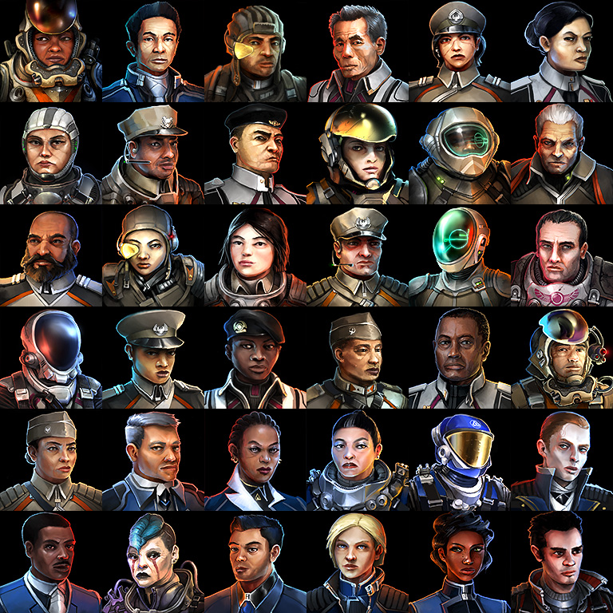
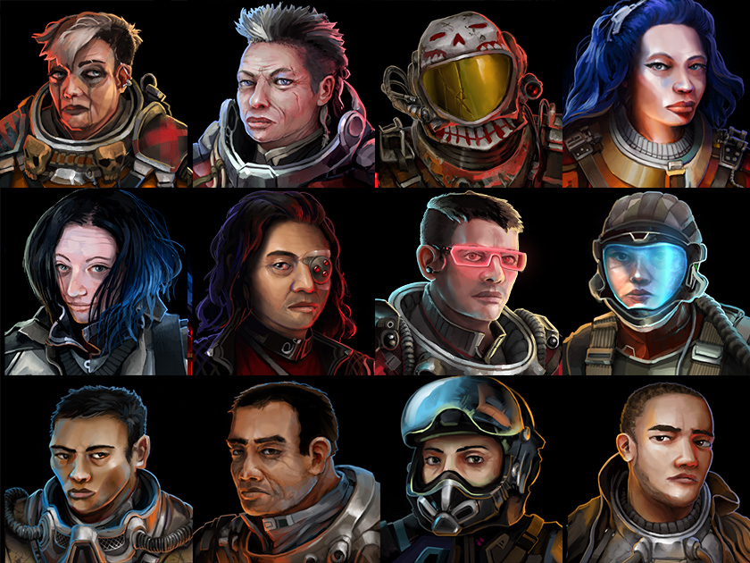
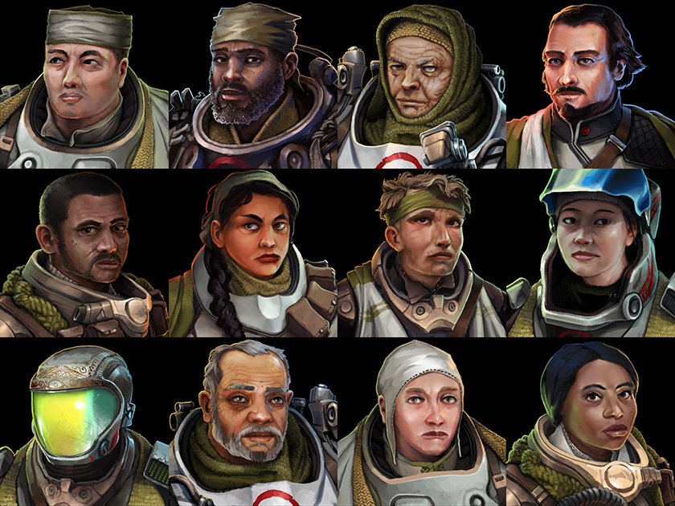
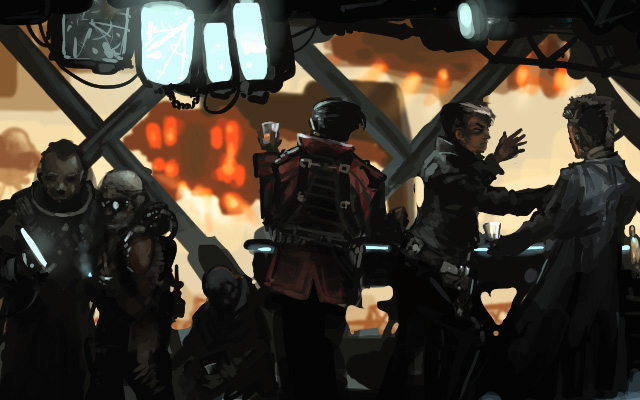
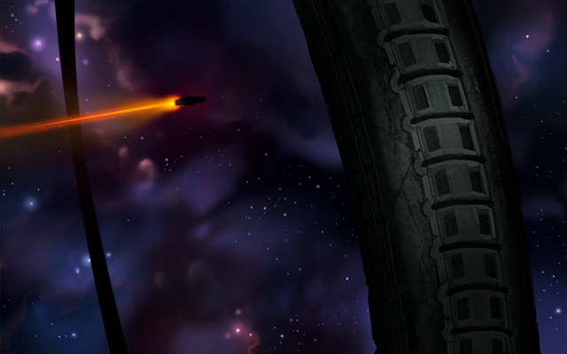
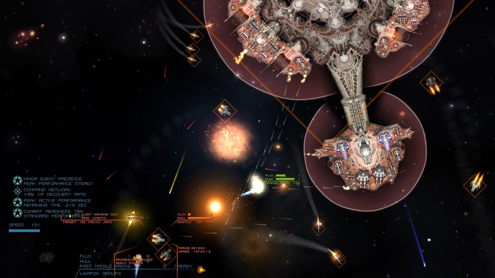

# 《远行星号 (Starsector)》深度技术与美术架构参考报告（AI Agent 专用版）

> **文档元信息 (Document Metadata)**
> - **目标受众**: 自动化游戏开发、美术管线生成与系统架构设计 AI Agent
> - **核实版本基准**: *Starsector* `0.97a` / `0.98a`（含深渊超空间 `Abyssal Hyperspace`、威胁 `[THREAT]`、幽影栖居者 `Shrouded Dwellers`、殖民地危机 `Colony Crises` 及 `Onslaught Mk.I` 机制）
> - **核心研发主体**: Fractal Softworks — 主程与引擎架构师 **Alex Mosolov**（Java + LWJGL/OpenGL）、首席美术与世界观编剧 **David Baumgart**
> - **文档结构**: 第一部分聚焦**美术体系、视觉语言与渲染管线**（约 55%~60% 权重）；第二部分聚焦**核心玩法机制、数据驱动架构与 Agent 复刻指南**（约 40%~45% 权重）。

---

## 第一部分：美术体系、视觉语言与渲染管线

### 1.1 美术指导哲学与工程约束 (Art Direction Philosophy & Engineering Constraints)

《远行星号》的视觉辨识度建立在**工业硬科幻（Industrial Hard Sci-Fi）**与**“衰败未来 / 旧化未来”（Used Future / Decadent Post-Collapse）**的叙事基调之上。游戏背景设定在“英仙座星区 (Persean Sector)”经历“大崩溃 (The Collapse)”数百年后的技术倒退期——人类不再拥有完整的多重工业母星体系，现存舰队普遍运行在修补、拼装与逆向工程的遗留科技上。

#### 1.1.1 David Baumgart 的手绘质感与“Greebling”尺度控制
* **从像素艺术到高精手绘 2D 混合体**: 在早期开发阶段（原名 *Starfarer*），游戏曾采用高密度传统像素风；随着分辨率提升与 David Baumgart 对资产管线的演进，正式版舰船 Sprite 演变为**带硬朗笔触的 2D 数字手绘（Hand-Crafted 2D Digital Painting）**，而非 3D 建模预渲染（Pre-rendered 3D）或程序化矢量拼接。这种选择使每艘舰船拥有高度统一的光影方向（固定顶光源/微斜侧光烘焙在底图上）与手工雕琢的材质磨损感。
* **微结构细节（Greebling）与比例尺传达**: 为了在纯 2D 俯视角下让 30 米长的护卫舰 (Frigate) 与 500 米级的主力舰 (Capital Ship) 产生截然不同的体量感，Baumgart 大量运用了 **Greebling（机械微结构堆叠）**——即在舰体表面绘制密集的装甲接缝、管线外露、散热格栅、检修舱口、雷达天线、警示条纹（Hazard Stripes）及结构加强筋。
  * **尺度法则**: 护卫舰的装甲板接缝宽大、部件占比高；主力舰（如霸主 `Onslaught` 或速子 `Paragon`）则通过极高密度的微小像素级面板分割与成比例缩小的舰桥/炮塔基座，强迫人脑在视觉上感知“庞然大物”的压迫感。

#### 1.1.2 高可读性俯视角 2D 设计原则 (Top-Down 2D Readability)
在后期百舰级混战、满屏弹幕与粒子特效的极端视觉噪音环境下，玩家必须在 200ms 内判断敌我舰船型号、朝向、炮塔指向与受损状态。为此，美术管线严格遵守以下约束：
1. **剪影优先（Silhouette First）**: 舰船轮廓必须在纯黑剪影下依然具备唯一可识别性（例如 `Onslaught` 的双前伸装甲钳角、`Paragon` 的圆环镂空中心、`Conquest` 的不对称长条战列巡洋舰身）。
2. **受控的视觉噪点（Controlled Visual Noise）**: 舰体表面的 Greebling 对比度被严格限制在**中低明度区间**，高饱和度色彩仅保留给三类功能元素：**派系识别条纹**、**引擎喷口尾焰**、**武器开火与护盾气泡**。
3. **明确的朝向锚点（Directional Anchors）**: 所有舰船 Sprite 统一朝向正上方（引擎在下方，主炮与舰首在上方，内部逻辑角度中 `0°` 或 `90°` 需与 `.ship` 坐标轴对齐），且通过舰首装甲楔形、驾驶舱视窗或前向推进器阵列强化方向感。

> **[Agent 设计启发式规则 | Design Heuristics — 2D 太空美术定调]**
> - **H-ART-01（对比度分层律）**: 宇宙背景亮度保持在 `5%–15%`，舰体底图明度控制在 `25%–65%`，而武器光束、护盾与引擎尾焰占据 `80%–100%` 亮度与 Additive 叠加通道，确保前景战斗信息永远不被背景星云吞没。
> - **H-ART-02（体量与微细节反比律）**: 舰船像素尺寸每翻倍，单个装甲分块（Panel）的相对像素占比应减半，通过增加分块数量而非放大纹理笔触来体现巨构感。

#### 1.1.3 舰级视觉比例与民用/军用结构原型
在俯视角 2D 空间中，若缺乏统一的尺度锚点，玩家极易混淆一艘小型驱逐舰与大型巡洋舰。David Baumgart 通过以下三组结构原型强行锚定舰船体量与用途：
* **舰级尺度阶梯（Hull Size Visual Scaling）**:
  * **护卫舰 (`Frigate`)**: 像素尺寸紧凑，单门小型炮塔即可占据舰体 `15%–25%` 的面积，视觉重心高度集中在主引擎喷口与单组前向武器，整体呈现“战斗机放大版”的敏捷感。
  * **驱逐舰 (`Destroyer`)**: 出现明确的“舰体中轴线与两侧翼舱”结构分化，开始配备中型炮塔基座与独立舰桥塔楼，比例接近现代海军驱逐舰。
  * **巡洋舰 (`Cruiser`)**: 具备明显的多段式装甲分区（舰首突击甲板、中段动力舱/机库、舰尾主推进阵列），表面 Greebling 密度显著提高，出现双联装或大型武器凹槽。
  * **主力舰 (`Capital Ship`)**: 采用“移动要塞 / 浮动船坞”构图，舰桥极度微缩化以衬托舰体庞大，常包含内部镂空结构（如 `Paragon` 的中心环）、多组独立大型推进器集群以及覆盖全舰的厚重装甲分割线。
* **军用与民用船体视觉区分**: 民用舰船（如 `Colossus` 货轮、`Phaeton` 油轮、`Prometheus` 超级油轮）刻意破坏军事舰船的流线型或厚重装甲包覆，大量采用**外露球形/柱形燃料罐、标准化集装箱模块、不对称侧置驾驶舱以及工业黄/警示橙涂装**。这种视觉语言在海盗或卢德左径将其改造为自爆舰或武装货轮时，能形成极强的“战时应急拼装”叙事张力。

---

### 1.2 派系视觉语法矩阵 (Faction Visual Grammar Matrix)

《远行星号》将舰船视觉风格划分为三大基础技术范式（**低科 Low-Tech**、**中线 Midline**、**高科 High-Tech**）以及多个独立/非人/深渊派系。AI Agent 在生成或分类派系资产时，必须严格遵循下表的视觉语法约束：

| 派系 / 技术范式 | 英文原名 | 主色调与点缀色 (Color Palette) | 舰体轮廓语言 (Silhouette Grammar) | 装甲纹理与材质 (Armor & Material) | 武器与引擎光效 (Weapon & Thruster VFX) |
| :--- | :--- | :--- | :--- | :--- | :--- |
| **低科范式 / 霸主** | `Low-Tech` / `Hegemony` | 橄榄绿、军用灰绿、炭黑、深钢灰；警示黄黑条纹 | 厚重方正、粗犷工业风、类似水上战列舰或重型工程机械，多钝角与外露框架 | 铆接厚装甲板、明显焊缝、掉漆与烟熏旧化、大量实弹炮塔基座 | 橙红色/明黄色粗壮化学能尾焰；实弹曳光弹、重型榴弹炮火光与黑烟 |
| **霸主第十四战斗群** | `XIV Battlegroup` | 深绯红/暗红 (`Crimson`) + 皇家金 (`Gold`) 镶边 + 深铁灰底色 | 与标准低科共享船体，但前部通常焊接额外厚重复合装甲块 | 仪式感与重装感并存，保留帝国时代“领域 (Domain)”海军涂装规范 | 同低科橙红尾焰，但通常伴随更密集的实弹齐射与导弹尾迹 |
| **中线范式 / 英仙座联盟** | `Midline` / `Persean League` | 洁净灰白、海军蓝 (`Navy Blue`)、炭灰、亮黄/金色条纹 | 流线型、对称、现代海军驱逐舰/航母感，比例修长均衡 | 标准化模块化装甲、接缝整洁、极少锈迹，体现联合舰队制式工业水平 | 亮黄色或暖金色离子/化学混合尾焰；实弹与能量武器混编，光效均衡 |
| **辛达强权** | `Sindrian Diktat` | 亮绯红 (`Red`)、高饱和金色 (`Gold`)、刺眼纯白 (`Stark White`) | 混用中线与低科平台（如 `Eradicator`、`Pegasus`、`Executor`），具阅兵仪仗感 | 光滑涂装覆盖粗犷底盘，带有强烈的个人崇拜与威权装饰条纹 | 暖橙/金色引擎焰；偏好高能等离子/激光与重型导弹齐射 |
| **高科范式 / 速子科技** | `High-Tech` / `Tri-Tachyon` | 珍珠白、银灰、亮青色 (`Teal`)、深宇宙蓝、淡紫 | 有机流线型、蝠鲼 (Manta-ray) 或月牙形、多悬浮/镂空结构、无传统炮塔感 | 极度光滑的复合材料外壳、极少机械铆钉、表面嵌有发光导能槽 | 亮青色/电蓝色冷光尾焰；高能光束、等离子球、相位残影（紫/青） |
| **卢德教会 / 卢德左径** | `Luddic Church` / `Luddic Path` | 教会：深绿、褐铁、素白宗教徽记；左径：铁锈红、暗褐、焦黑涂鸦 | 改装民用货轮与低科老旧舰体，结构笨重不对称，常焊有冲角或简易装甲 | 严重锈蚀、补丁焊接、宗教经文或手绘红漆标记，体现苦行与狂热 | 浑浊橙黄废气尾焰；偏好非制导火箭、重型实弹、自杀式突击火光 |
| **海盗** | `Pirates` | 暗红、铁锈褐、黑灰底色 + 杂乱白/红骷髅或锯齿涂装 | 在民用/低科/中线残骸上强行焊接额外挂点（`.skin` 变体典型代表） | 极度破败、拼凑感强、装甲颜色不统一、外露管线与临时补丁 | 不稳定橙红尾焰（常带黑烟颗粒）；廉价导弹与近距离混战实弹 |
| **遗迹 AI** | `Remnant ([REDACTED])` | 黑曜石黑 (`Obsidian`)、枪械金属灰 + 高对比荧光青 (`Cyan`) / 电蓝节点 | 高度非人几何体、尖锐锯齿、昆虫状或晶体状、不对称或绝对对称分形 | 未知超黑合金、无缝隙一体化表面、内部透出脉冲能量电路 | 刺眼电青色脉冲尾焰与残影；高频激光、电弧与高速能量弹幕 |
| **欧米伽** | `Omega` | 虚空黑 (`Void-Black`)、深紫 (`Deep Violet`)、品红/血红脉冲梯度 | 违背人类造船工程学的超现实几何体，动态分裂/重组感（如 `Tesseract`） | 纯能量与暗物质交织的非欧几里得表面，视觉上具有强压迫感与诡异感 | 紫红/品红裂隙光束与空间扭曲特效，击毁后可分裂为次级子体 |
| **威胁 (`0.98a`)** | `[THREAT]` | 暗沉工业铁灰、焦黑金属 + 冰冷暗红/橙白工业焊弧光 | 领域时代失控的自我复制 AI 舰队；外观呈重工业蜂巢/施工母舰形态（如 `Fabricator`） | 粗糙的领域早期自动化结构、外露建造机械臂与模块化组装骨架 | 持续性蜂群无人机释放、重型工业激光与高热电弧 |
| **幽影栖居者 (`0.98a`)** | `Shrouded Dwellers` | 深渊黑紫、幽灵暗红/苍白荧光脉络 | 纯粹的宇宙恐怖（Cosmic Horror）非人生物/能量聚合体（如 `Tendrils`、`The Gaze`） | 半透明/扭曲的生物质与裂隙能量混合轮廓，无任何人类机械结构 | 致命高能深渊凝视光束（`Abyssal Glare`）、裂隙能量脉冲与诡异空间波纹 |

#### 1.2.2 派系武器视觉语言与弹道/光束特征
在《远行星号》的战斗画面中，武器的视觉表现直接承担了“伤害类型识别”与“派系身份传达”的双重职责：
* **低科与霸主实弹武器**: 强调物理后坐力与火药燃气感。重型实弹炮（如 `Hellbore Cannon`、`Hephaestus Assault Gun`）在开火瞬间于炮口生成暖橙色/明黄色多瓣状枪口焰（Muzzle Flash）与灰白色烟尘粒子；高速动能弹丸（如 `Railgun`、`Gauss Cannon`）则采用细长高亮的白蓝/金黄曳光核心，配合高速消散的尾迹线表达极高初速。
* **中线与制式导弹武器**: 导弹尾部拖曳高饱和度的白灰烟柱（低科/中线）或明亮离子尾迹（高科），弹头在接近目标护盾时伴随制导推进器的侧向微调喷射火花，强化追踪动态。
* **高科与速子科技能量武器**: 摒弃实体炮管后坐力，代之以炮口导能环蓄能发光（Charge-up Glow）。等离子武器（如 `Plasma Cannon`）发射高亮度青绿色/亮蓝色球形能量团，边缘包裹柔光辉晕；重型光束（如 `Tachyon Lance`）则呈现瞬间贯穿屏幕的刺眼电蓝色直线激光，命中护盾或装甲时在交点处爆发出持续的高频电弧火花。
* **遗迹 AI 与欧米伽异象武器**: 遗迹武器偏好高频脉冲青光与多发散射光束；欧米伽武器（如 `Rift Lance`、`Reality Disruptor`）则打破传统光束的笔直形态，采用暗紫/品红双色交织的裂隙能量带与空间撕裂闪光，视觉上直接暗示其超越常规人类物理学的危险性。
* **深渊势力武器 (`0.98a`)**: `[THREAT]` 阵营依赖高热工业焊弧激光与密集自爆/维修无人机蜂群；而 `Shrouded Dwellers` 的标志性武器（如 `Abyssal Glare`）则投射出暗红与苍白交错的深渊凝视射线，伴随令人不安的扭曲暗影粒子。

---

### 1.3 舰船与武器 Sprite 资产管线 (Ship & Weapon Sprite Asset Pipeline)

《远行星号》的战斗画面并非静态贴图移动，而是由一套精密的多图层装配与坐标映射系统实时合成。

#### 1.3.1 舰船分层渲染结构 (Multi-Layer Composition)
一艘舰船在战斗场景中的视觉表现由以下 7 个逻辑图层从下到上叠加而成：
1. **底层引擎尾焰与烟迹 (`Thrusters & Contrails`)**: 依据 `.ship` 文件中的 `engineSlots` 生成，位于舰体下方或尾部喷口处，随舰船加速、转向与过载状态动态缩放长度与亮度。
2. **基础舰体底图 (`Base Hull Sprite`)**: 源自 `spriteName` 指定的 PNG 文件（RGBA 带透明通道）。已预先烘焙好顶部/微斜侧方向的环境光遮蔽（AO）与 Greebling 阴影。
3. **动态损伤与烧灼遮罩层 (`Damage & Scorch Overlay`)**: 当舰体护甲受损或船体着火时，引擎在底图之上实时混合焦黑弹坑、熔融金属边缘与结构破口纹理（详见 1.3.3）。
4. **内置/装饰动画部件 (`Built-in / Decorative Animated Parts`)**: 如航母甲板上的战机起降指示灯、旋转雷达、可动装甲翼片（如 `Astral` 或 `Conquest` 的特定装饰武器位），通常通过 `DECORATIVE` 类型武器位挂载。
5. **武器挂点 (`Weapon Mounts`: `HARDPOINT` vs `TURRET`)**:
   * **固定挂点 (`HARDPOINT`)**: 武器 Sprite 嵌在舰体预设凹槽内，射界极窄（`arc` 通常为 `0°–15°`），渲染顺序常在舰体装甲边缘之下或齐平，强调“内置重炮”感。
   * **旋转炮塔 (`TURRET`)**: 武器拥有独立的底座 Sprite（`turretUnderSprite`）与炮管 Sprite（`turretSprite`），在舰体顶层绕挂点坐标 `loc` 自由旋转，开火时沿局部后坐力向量产生像素级位移（Recoil Animation）。
6. **发光与自发光层 (`Glow / Emissive`)**: 武器充能时的炮口发光贴图（`glowSprite`）、舰体导能槽脉冲以及舰船系统激活时的边缘高光。
7. **护盾气泡 (`Shield Bubble`)**: 围绕 `shieldCenter` 以 `shieldRadius` 为半径绘制的半透明能量弧，具有动态展开/收拢动画（Unfold Animation），并依据当前护盾覆盖角度（`arc`）与受击位置产生涟漪与亮度脉冲。

#### 1.3.2 像素坐标系与锚点规范 (Coordinate System & Origin)
Agent 在解析或生成 `.ship` 资产数据时，必须注意 Starsector 特有的**像素坐标与逻辑坐标转换规则**：
* **图像文件基准**: PNG 图片的左下角为 `(0, 0)`。
* **舰体中心 (`center: [cx, cy]`)**: 定义舰船物理旋转中心与坐标原点 `(0, 0)` 在 PNG 图像中的像素位置。
* **子部件偏移**: 所有 `weaponSlots` 的 `loc`、`engineSlots` 的 `location`、`shieldCenter` 以及碰撞多边形 `bounds` 均以 `center` 为 `(0, 0)` 进行相对偏移定义。
* **朝向约定**: 在资产贴图中，舰首通常朝上（+Y 方向），但在游戏引擎内部计算中，`0°` 通常对应正右方或依据 `angle` 字段定义（`engineSlots` 中 `180°` 表示向正后方喷射尾焰）。

#### 1.3.3 损伤可视化与断舰碎裂逻辑 (Damage Visualization & Hull Splitting)
* **局部装甲网格映射 (Localized Armor Grid)**:
  Starsector 不使用单一全局护甲值，而是将每艘舰船的 Sprite 空间划分为离散的**二维装甲网格（Armor Grid）**（每个网格单元通常对应约 `15×15` 像素或按舰船尺寸映射的固定像素块）。当炮弹击中特定多边形边界时，引擎计算击中点及周围圆形溅射半径内的网格单元护甲衰减。
* **视觉反馈映射**:
  * **护甲剥离与焦痕**: 当某网格单元的护甲值降至较低百分比时，渲染器会在对应局部坐标叠加多层焦黑（Scorch）、弹孔（Pockmarks）及内层裸露的暗红色炽热金属纹理，使玩家无需看面板即可通过观察舰体外观判断“哪一侧装甲已被打穿（Stripped）”。
* **船体摧毁与断舰碎裂 (Ship Destruction & Hulks)**:
  * 当舰体结构值（Hull）归零时，不会瞬间消失，而是触发**殉爆序列**：先经历数次局部次级爆炸（伴随高亮度闪白与碎片飞溅），随后舰船或保持完整变为焦黑漂浮的**残骸（Hulk）**，或在特定重击/高危核心殉爆下沿预设或随机裂解线**断裂为多个独立物理残骸块（Split Hull Pieces）**。
  * 这些残骸依然保留物理碰撞体积，可阻挡后续实弹与光束（甚至作为临时掩体），并在战斗结束后进入打捞（Salvage）结算池。

#### 1.3.4 武器与弹丸资产结构 (`.wpn` 与 `.proj` 视觉管线)
与舰船底图分离，每门可挂载武器均由 `.wpn` 蓝图驱动其多图层动态表现：
* **双层炮塔结构 (`turretSprite` & `turretUnderSprite`)**: 旋转炮塔通常拆分为底座贴图（随舰体固定或微动）与上层炮管贴图（精确指向目标）。对于固定挂点（`HARDPOINT`），则使用对应的 `hardpointSprite` 与 `hardpointUnderSprite`，使其无缝嵌入舰体装甲凹槽。
* **发光与后坐力动画**: `turretGlowSprite` 与 `hardpointGlowSprite` 仅在武器开火或蓄能时通过 Additive 混合叠加在炮管表面；`visualRecoil` 参数控制每次开火时炮管沿局部 `-Y` 轴向后缩进的像素距离，随后按阻尼曲线回弹，赋予实弹火炮极强的机械重量感。
* **帧动画武器 (`numFrames` & `frameRate`)**: 诸如转管加特林、脉冲能量环或装饰性旋转雷达，通过在单张 PNG 中横向排列动画帧并由 `.wpn` 中的 `numFrames` 与 `frameRate` 驱动循环播放。
* **弹丸分层着色 (`.proj`)**: 实弹与能量弹丸在 `.proj` 中并非单色块，而是通过 `coreColor`（高亮度白/浅色内核）与 `fringeColor`（高饱和度外围辉光）双层叠加，确保弹丸在任意深空或星云背景下均保持锐利边缘。

---

### 1.4 特效 (VFX)、着色器与光影系统 (VFX, Shaders & Lighting Pipeline)

#### 1.4.1 LWJGL / OpenGL 2D 渲染管线架构
主程 Alex Mosolov 采用 **Java + LWJGL (Lightweight Java Game Library)** 直接封装 OpenGL 进行硬件加速 2D 渲染。由于后期大规模舰队战需要同屏处理数百艘舰船/战机、数千发弹丸与海量粒子，渲染管线高度依赖**状态切换最小化**与**纹理批处理（Sprite Batching）**。

```
[渲染管线执行序列 Render Pass Order]
Pass 1: 视差深空背景 (Parallax Starfields + Procedural Nebulae + Coronas)
Pass 2: 战场地面/空间效果 (Battlefield Dust / Slipstream / Minefield Rings)
Pass 3: 舰船底层轨迹 (Engine Contrails + Phase Cloak Afterimages)
Pass 4: 舰体与损伤层 (Ship Hulls + Armor Scorch Masks + Wrecks)
Pass 5: 武器与弹丸层 (Turrets + Projectiles + Missiles)
Pass 6: 叠加混合光效层 [GL_SRC_ALPHA, GL_ONE] (Beams + EMP Arcs + Muzzle Flashes + Explosions)
Pass 7: 护盾与空间扭曲 (Shield Bubbles + Shockwave Refraction / Distortion)
Pass 8: 战术 HUD 与世界空间 UI (Target Brackets + Flux Bars + Tactical Overlay)
```

#### 1.4.2 关键特效实现细节
1. **叠加混合 (Additive Blending)**:
   几乎所有能量武器、引擎尾焰、爆炸核心、光束（如 `Tachyon Lance`）与护盾受击闪光均采用 OpenGL 加法混合（`glBlendFunc(GL_SRC_ALPHA, GL_ONE)`）。多个光效重叠时自然产生向纯白过曝的视觉效果，无需复杂 HDR 管线即可营造出极强的能量感。
2. **光束武器与电弧 EMP**:
   * **光束 (`Beam`)**: 由核心高白亮带 + 外围彩色辉光带 + 起点/终点动态冲击粒子组成，宽度随充能与衰减周期（`fadeIn` / `fadeOut`）平滑插值。
   * **电弧 (`EMP Arc`)**: 采用程序化中点位移算法（Midpoint Displacement / Jagged Polyline）在起点与随机/目标受击点之间实时生成折线闪电，配合高频闪烁与局部电火花粒子，直观传达“武器/引擎瘫痪”状态。
3. **爆炸冲击波与热浪扭曲 (Shockwave & Distortion)**:
   大型主力舰殉爆或鱼雷命中时，除了多层叠加的火球 Sprite 与碎片粒子外，还会触发向外高速扩散的半透明环状冲击波，结合帧缓冲（Framebuffer）采样偏移或社区常用的 GLSL Shader（如 *GraphicsLib* 生态所扩展的法线/扭曲管线）制造局部空间折射感。
4. **相位隐身 (Phase Cloak) 视觉语言**:
   开启相位的舰船（如 `Doom`、`Harbinger`、`Afflictor`）会切换至独立的深紫/幽蓝半透明渲染态，舰体边缘产生频率抖动，并在移动轨迹上留下快速消散的**残影（Afterimages）**。由于相位状态下时间流速加快（Time Dilation），其残影间距与周边慢速弹幕形成鲜明的速度对比。
5. **辐能过载与主动排散粒子 (Overload & Venting VFX)**:
   * **主动幅散 (`Venting`)**: 舰船从各散热口向外喷射大量高速青白色/蓝白色蒸汽与等离子粒子流，明确告知敌我双方“该船处于无法开盾的脆弱窗口”。
   * **过载 (`Overload`)**: 舰船表面持续爆出失控的紫色/红色电弧与故障火花，护盾强制熄灭，武器与引擎全面停摆。
6. **超空间视差背景 (Hyperspace & Star System Parallax)**:
   恒星系内通过多层不同移动倍率（Parallax Factor）的星尘与星云纹理模拟纵深；恒星日冕（Corona）与超空间风暴（Hyperspace Storm）采用动态旋转与噪点叠加纹理；`0.97a/0.98a` 引入的**超空间滑流 (Slipstream)** 则表现为宽阔的、带有高速流动方向矢量的青蓝色能量洋流带。

#### 1.4.3 着色器管线与大规模战斗性能批处理 (Shaders & Render Batching)
在 Java + LWJGL 的 2D 渲染架构下，后期百舰混战的瓶颈往往不在 GPU 像素填充率，而在 CPU 到 GPU 的 **Draw Call 数量**与 **OpenGL 状态切换（State Changes）**。
* **渲染状态排序与批处理**: 引擎将所有同类型、同混合模式（如标准 Alpha 混合 vs Additive 加法混合）的粒子、弹丸与尾焰尽量合并提交，避免在每一帧内频繁切换 `glBlendFunc` 或绑定/解绑纹理。
* **高刷新率与现代 LWJGL 适配**: 随着 Alex Mosolov 对底层 LWJGL 版本的持续更新与渲染路径优化，引擎能够稳定支持高刷新率显示器并开放了自定义 GLSL 片段/顶点着色器接口。例如，社区广泛使用的 *GraphicsLib* 渲染扩展正是通过挂载游戏暴露的渲染钩子，在帧缓冲（Framebuffer）阶段注入法线贴图（Normal Mapping）、动态点光源漫反射、以及全屏泛光（Bloom）与冲击波折射（Screen-Space Distortion），证明了底层 2D 场景图与现代可编程管线的高度兼容性。

---

### 1.5 角色立绘与叙事插画美术 (Character Portraits & Illustrations)

尽管核心战斗是 2D 俯视角舰船，但《远行星号》的 RPG 叙事、外交对话与军官招募高度依赖 David Baumgart 绘制的**角色立绘（Portraits）**与事件插画。

* **数字厚涂风格（Painterly Digital Impasto）**: 立绘摒弃了日系赛璐璐平涂或过度光滑的商业 CG 质感，保留了清晰、有力度的硬边笔触（Brushstrokes）来塑造面部骨骼结构、褶皱与金属反光。
* **光影与情绪表达**: 普遍采用**冷暗工业环境光 + 强局部点光源**（如来自头盔面罩、全息投影仪或红色警戒灯的侧逆光），营造出宇宙边缘地带特有的压抑、神秘与冷峻感。
* **派系视觉符号学**:
  * **霸主军官**: 笔挺的暗绿/深灰高领军装、勋章、严谨的军帽或老式通讯耳机。
  * **速子科技高管/特工**: 剪裁极简的洁白/深蓝高领制服、半面部机械义体、冷青色发光护目镜或神经接口。
  * **卢德教会/左径**: 粗麻布兜帽、手绘宗教符号、破旧宇航服与狂热的眼神光影。
  * **海盗与自由船长**: 杂乱的皮革/旧宇航服混搭、明显伤疤、粗糙移植的红光义眼。
* **多尺度复用性**: 所有立绘在绘制时即确保在 `128×128` 甚至 `48×48` 的 UI 缩略框中依然能通过轮廓、帽饰与高饱和度点缀色（如红义眼、金肩章）实现一眼识别。

#### 1.5.1 官方立绘与叙事插画视觉参考（David Baumgart 原作）

*图 1-1：David Baumgart 绘制的游戏内角色立绘合集（体现硬边厚涂笔触、暗色背景与高饱和度局部点缀色）。*


*图 1-2：海盗与自由雇佣兵派系立绘（粗糙义体、伤疤、非制式宇航服与暗红/暖橙危险侧光）。*


*图 1-3：卢德教会/左径派系立绘（粗麻兜帽、苦行材质与宗教符号）。*


*图 1-4：空间站酒吧（Space Bar）事件插画——冷色全息光幕与暖橙工业背景的冷暖对冲构图。*


*图 1-5：古代领域星门（Domain Gate）事件插画——巨构尺度的压迫感与深空微弱点光源。*


*图 1-6：饱和轰炸（Saturation Bombardment）叙事插画——低明度剪影与高对比度火光爆发。*

#### 1.5.2 立绘资产生成与视觉一致性规范 (Agent Prompt & Asset Spec)
若 AI Agent 需要批量生成或筛选符合《远行星号》世界观的角色立绘，应强制注入以下视觉约束：
* **构图与视角**: 胸部以上半身特写（Bust-up Portrait），轻微三七侧脸（3/4 Profile），背景为失焦的暗色舱壁、金属桁架或微弱全息栅格，严禁出现纯白或高饱和度风景背景。
* **材质与笔触**: 保持可见的厚涂硬边笔触（Painterly Digital Impasto），皮肤纹理带有疲惫感、油污或伤痕，金属义体呈现哑光钛合金或磨损黄铜质感，避免现代光滑塑料感。
* **色彩受控**: 整体画面饱和度压低至 `20%–40%`，仅允许在一个核心功能点（如发光护目镜、领章徽记、通讯耳麦指示灯）使用 `80%+` 高饱和度点缀色，以保证与游戏内暗色 UI 对话框的完美融合。

---

### 1.6 UI / HUD / 战术界面美术与色彩编码 (UI / HUD & Tactical Interface Art)

《远行星号》的 UI 被公认为硬核策略游戏信息密度与清晰度平衡的典范，其核心是一套**严格全局一致的语义色彩编码系统（Semantic Color Coding）**。

#### 1.6.1 全局色彩编码规范
| 颜色通道 | 语义映射 (Semantic Meaning) | 典型应用场景 |
| :--- | :--- | :--- |
| **青色 / 亮蓝 (`Cyan / Bright Blue`)** | 友军能量、护盾完整性、软辐能 (`Soft Flux`)、安全状态 | 玩家护盾弧、辐能条中的软辐能填充、幅散粒子、友好势力标识 |
| **纯白 / 亮灰 (`White / Light Grey`)** | 硬辐能 (`Hard Flux`)、高优先级警告文本 | 辐能条中无法在开盾时消散的硬辐能段（与青色软辐能形成直观堆叠对比） |
| **正红 / 橙红 (`Red / Orange-Red`)** | 敌对单位、装甲危险/剥离、过载警告、热能过载 | 敌舰瞄准框、装甲受损提示、过载倒计时闪烁、武器射程不足提示 |
| **翠绿 (`Green`)** | 玩家自身/友军单位、船体结构 (`Hull`) 健康度、收益正反馈 | 战术地图友军图标、船体结构绿条、殖民地盈利数值 |
| **琥珀黄 (`Amber / Yellow`)** | 中立单位、警告/注意阈值、后勤补给消耗 | 中立舰队框、CR 低于 70% 警告、燃料/补给不足提示 |

#### 1.6.2 装配界面 (Refit Screen) 与槽位图标化
在装配界面中，舰船被置于带有精密像素网格（用于直观比对舰体大小与射界）的蓝图背景上。不同性质的武器槽位通过**形状 + 颜色**双重编码区分，确保色盲玩家与高速操作时零误判：
* **实弹 (`BALLISTIC`)**: 黄色/琥珀色边框。
* **能量 (`ENERGY`)**: 青色/蓝色边框。
* **导弹 (`MISSILE`)**: 绿色边框。
* **混合 (`HYBRID` = 实弹+能量)**、**复合 (`COMPOSITE` = 实弹+导弹)**、**协同 (`SYNERGY` = 能量+导弹)**、**通用 (`UNIVERSAL`)**: 分别采用对应双色对角线或白/灰多色组合图标，配合尺寸符号（小 `S`、中 `M`、大 `L`）形成完整的信息矩阵。

#### 1.6.3 战略星图与传感器圈层设计 (Campaign Map & Sensor Rings)
战略大地图采用深色调低对比度星图网格，核心信息通过**同心圆虚线/实线圈层**表达：
* **传感器探测半径 (`Sensor Range`)**: 围绕玩家舰队的青色渐隐圆环，直观展示“我能看到多远”。
* **被探测半径 (`Detected-At Range`)**: 依据当前舰队信号特征（Sensor Profile）动态缩放的警戒圈。当玩家开启 `Go Dark` 时该圈急剧收缩；开启 `Sustained Burn` 或 `Active Sensor Burst` 时该圈剧烈扩张，将复杂的隐匿数值转化为直观的几何空间博弈。

#### 1.6.4 战斗 HUD 微交互与战术地图视图 (Combat HUD & Tactical Overlay)
在实时战斗中，玩家同时操控旗舰并指挥全舰队，HUD 必须在极小屏幕占比内提供高密度的状态反馈：
* **世界空间微指示器**: 鼠标悬停或锁定敌舰时，其四周出现四向动态瞄准框（Target Brackets），并紧邻舰体渲染**前置弹道预测环（Lead Indicator）**——基于当前选中武器组的弹丸飞行速度与目标当前速度矢量实时计算提前量，极大降低了 2D 惯性飞行中的瞄准门槛。
* **左下角本舰状态面板**: 集中展示舰体结构（绿条）、装甲网格简图（实时同步局部受击变红/变黑）、双色辐能条（青色软辐能 + 白色硬辐能叠加），以及 `1–7` 号武器编组栏（清晰标识武器冷却进度、弹药余量与 `Autofire` 自动开火激活框）。
* **战术指挥视图 (`Tab` 键)**: 一键切换为高度抽象的矢量符号俯瞰图。所有复杂手绘舰船简化为带朝向尖角的几何图标（三角/菱形/六边形区分舰级），实时显示射程圈、护盾朝向弧以及友军正在执行的航路点/集火连线，实现了“动作射击操作”与“RTS 全局微操”的无缝切换。

---

### 1.7 视听协同反馈机制 (Audio-Visual Synergy)

虽然视觉承担了 80% 的信息传递，但 Starsector 极度依赖音效与镜头物理反馈来放大“太空巨舰交火”的打击感：
1. **受击与开火镜头震动 (Screen Shake)**: 重型实弹（如 `Hellbore Cannon`）开火或主力舰护盾过载/殉爆时，依据距离与能量等级施加衰减式镜头震动。
2. **命中视觉顿挫与闪白**: 高爆弹或鱼雷击中无盾装甲时，触发局部亮白闪光（Hit-Flash）与密集碎甲粒子，配合低沉闷响的金属撞击音效，与击中护盾时的清脆高频电子嗡鸣形成截然不同的材质反馈。
3. **深渊与异象音频引导 (`0.98a`)**: 在深渊超空间探索时，面对 `[THREAT]` 或 `Shrouded Dwellers` 等非人实体，游戏通过低频环境嗡鸣、扭曲的电子脉冲声与诡异音效提示危险迫近，强化视觉上的未知恐惧。

#### 1.7.1 视听耦合触发矩阵 (Audio-Visual Coupling Matrix)
| 战斗/探索事件 | 视觉反馈通道 (Visual Channel) | 音频与镜头通道 (Audio & Camera Channel) |
| :--- | :--- | :--- |
| **护盾受击 (实弹/能量)** | 护盾弧局部高亮涟漪 + 青色/白色闪光粒子 | 高频电磁嗡鸣与能量偏转爆裂声（无镜头震动） |
| **无盾装甲受击 (高爆/重炮)** | 局部闪白 (`Hit-Flash`) + 熔融火花 + 焦痕网格叠加 | 低沉金属撕裂/厚重撞击声 + 依距离衰减的轻度震动 |
| **主动幅散 (`Venting`)** | 散热口喷射高速青白蒸汽粒子流，护盾熄灭 | 持续高压气体泄压嘶鸣声（提示敌我双方处于脆弱窗口） |
| **辐能过载 (`Overload`)** | 舰体表面随机爆出紫红色失控电弧与故障火花 | 刺耳的电路短路爆音与系统下线降调电子音 |
| **主力舰殉爆 (`Capital Explosion`)** | 多次次级闪白爆炸 -> 扩张冲击波环 -> 断舰残骸 | 延迟抵达的低频深空爆轰声 + 强力屏幕震动 |

#### 1.7.2 实时战斗画面与本地视觉参考图库索引

*图 1-7：实机战术海战画面——直观展示 2D 俯视角舰船剪影、青色护盾弧、光束与粒子 Additive 混合、敌我瞄准框及左下角状态面板的语义色彩分层。*

> **本地已归档视觉参考资产目录 (`docs/images/starsector/`)**：
> - 立绘图集：`portrait_game_scale.jpg`、`portrait_pirates_mercs.jpg`、`portrait_luddic.jpg`、`portrait_league.jpg`、`portrait_alpha_centauri.jpg`、`portrait_sebestyen.jpg`
> - 叙事事件插画：`illus_space_bar.jpg`、`illus_gate.jpg`、`illus_bombardment_saturation.jpg`、`illus_survey1.jpg`、`illus_eochu_bres.jpg`、`illus_bar_hegemony.jpg`
> - 战斗实机参考：`gameplay_rps_combat.jpg`

---

## 第二部分：核心玩法机制、数据驱动架构与 Agent 复刻指南

### 2.1 实时战术海战机制 (Real-Time Tactical Combat Mechanics)

《远行星号》的战斗系统本质上是一个**以“热量/辐能管理”为核心约束的动态博弈引擎**，彻底打破了传统太空游戏“谁血厚/DPS 高谁赢”的线性数值膨胀。

#### 2.1.1 辐能经济状态机 (Flux Economy State Machine)
每艘舰船拥有两个核心辐能参数：**辐能容量 (`Flux Capacity`)** 与 **辐能消散速率 (`Flux Dissipation / sec`)**。

* **软辐能 (`Soft Flux`)**: 由开火（能量/实弹武器）、维持护盾或承受**光束武器 (`Beam`)** 攻击产生。**软辐能可以在开启护盾的同时被被动消散**。
* **硬辐能 (`Hard Flux`)**: 由非光束武器（实弹、导弹、等离子弹丸）击中护盾或使用特定舰船系统产生。**硬辐能在护盾开启期间绝对无法消散**，必须关闭护盾或执行**主动幅散 (`Venting`)** 才能清除。
* **幅散 (`Venting`, `V` 键)**: 主动关闭所有武器与护盾，使辐能消散速率翻倍（`2.0x Dissipation`），直至辐能清零。期间舰船处于完全无防备状态。
* **过载 (`Overload`)**: 当 `Soft Flux + Hard Flux >= Flux Capacity` 时强制触发。舰船引擎熄火、护盾崩塌、武器离线数秒（时间随舰船等级与插件变化），且在过载结束前无法主动操作。

```
[舰船辐能状态机 Flux State Machine]
   +-------------------+  开火/受光束攻击   +-------------------+
   |   正常作战态      | -----------------> |   软辐能积累态    |
   |  (Normal/Idle)    | <----------------- | (Soft Flux > 0)   |
   +-------------------+   持续消散(可开盾)  +-------------------+
            |                                        |
            | 护盾承受非光束弹丸命中                   | 护盾承受非光束弹丸命中
            v                                        v
   +-----------------------------------------------------------+
   |                    硬辐能积累态 (Hard Flux > 0)            |
   |             * 开盾时硬辐能锁定，仅软辐能可消散 *             |
   +-----------------------------------------------------------+
       | 主动按 V 键幅散            | 关盾自然消散         | 总辐能 >= 容量上限
       v                            v                    v
+--------------+           +----------------+    +----------------+
|  主动幅散态   |           |  裸船消散态     |    |    过载态       |
|  (Venting)   |           | (Shields Down) |    |  (Overloaded)  |
| 2x 消散速率   |           | 1x 消散硬辐能   |    | 武器/盾/引擎瘫痪 |
| 禁武器/禁护盾 |           | 装甲直接承伤    |    | 持续数秒惩罚     |
+--------------+           +----------------+    +----------------+
```

#### 2.1.2 伤害类型矩阵与护盾效率
| 伤害类型 (`Damage Type`) | 对护盾 (`vs. Shield`) | 对装甲 (`vs. Armor`) | 对船体 (`vs. Hull`) | 战术定位与代表武器 |
| :--- | :---: | :---: | :---: | :--- |
| **动能 (`KINETIC`)** | **200% (2.0x)** | **50% (0.5x)** | **100% (1.0x)** | 专职压制护盾、快速制造硬辐能（自动炮、磁轨炮、`Needler`） |
| **高爆 (`HIGH_EXPLOSIVE`)** | **50% (0.5x)** | **200% (2.0x)** | **100% (1.0x)** | 专职撕裂重型装甲网格（迫击炮、`Hellbore`、鱼雷） |
| **能量 (`ENERGY`)** | **100% (1.0x)** | **100% (1.0x)** | **100% (1.0x)** | 泛用全能伤害（等离子炮、光束武器；注意光束打盾仅生软辐能） |
| **破片 (`FRAGMENTATION`)** | **25% (0.25x)** | **25% (0.25x)** | **100% (1.0x)** | 点防御 (PD) 拦截导弹/战机，或收割无甲裸露船体（火神炮 `Vulcan`） |

* **护盾效率 (`Shield Flux/Dmg`)**: 护盾吸收伤害时，按 `Incoming_Damage * Type_Multiplier * Shield_Efficiency` 转化为硬/软辐能。高科舰船（如 `Paragon`）通常拥有极低且优秀的护盾效率（如 `0.6–0.8`），而低科舰船效率较差（如 `1.2`），迫使其依赖厚重装甲抗线。

#### 2.1.3 离散装甲网格与核心减伤公式 (Armor Damage Formula)
Starsector 最具工程特色的数值设计在于其**非线性单发伤害抗性公式**，这使得“高单发重炮”与“高射速轻机炮”在面对重甲时产生本质差异：

$$\text{Damage Multiplier} = \frac{D_{\text{eff}}}{A_{\text{cell}} + D_{\text{eff}}}$$

其中：
* $D_{\text{eff}}$ 为**有效单发伤害 (`Effective Hit Damage`)**：即 `Base_Hit_Damage * Armor_Type_Multiplier`（高爆为 `2.0`，动能为 `0.5`，能量为 `1.0`，破片为 `0.25`）。对于**光束武器 (`Beam`)**，系统取其标称秒伤的 **50% (`0.5 * DPS`)** 作为计算穿透的等效 $D_{\text{eff}}$。
* $A_{\text{cell}}$ 为**受击位置装甲网格单元的当前有效装甲值**（注意：即使某格装甲被完全打穿，游戏仍保留 **5% 的最低残余装甲 (`Residual Armor`)**，防止高射速低伤武器在破甲后瞬间融化船体）。
* **减伤上限**: 常规装甲减伤率最高锁定在 **85%**（装备 `Polarized Armor` 等特定插件时可提升至 **90%**）。

```python
# Agent 复刻参考伪代码：Starsector 单格装甲损伤结算
def apply_armor_hit(cell_armor: float, base_armor: float, raw_hit_dmg: float, dmg_type: str, is_beam: bool, max_dr: float = 0.85) -> tuple[float, float]:
    """
    返回: (实际穿透至船体的伤害 hull_damage, 结算后该格剩余装甲 new_cell_armor)
    """
    type_mult = {"KINETIC": 0.5, "HIGH_EXPLOSIVE": 2.0, "ENERGY": 1.0, "FRAGMENTATION": 0.25}[dmg_type]
    eff_hit = (raw_hit_dmg * 0.5 if is_beam else raw_hit_dmg) * type_mult
    
    # 5% 最低残余装甲保底机制
    effective_armor = max(cell_armor, base_armor * 0.05)
    
    # 非线性减伤倍率
    raw_multiplier = eff_hit / (effective_armor + eff_hit) if (effective_armor + eff_hit) > 0 else 1.0
    damage_multiplier = max(raw_multiplier, 1.0 - max_dr)
    
    hull_damage = eff_hit * damage_multiplier
    # 装甲自身按有效伤害比例剥离（简化模型，实际含周围网格溅射）
    new_cell_armor = max(0.0, cell_armor - hull_damage)
    return hull_damage, new_cell_armor
```

#### 2.1.4 作战准备度 (CR) 与峰值作战时间 (PPT)
* **峰值作战时间 (`Peak Performance Time, PPT`)**: 舰船进入战斗部署后维持巅峰状态的倒计时（秒）。低科舰船 PPT 较长，高科与相位舰较短。**时间加速机制（如相位隐身 `Phase Cloak` 或 `Temporal Shell`）会按时间倍率加速消耗 PPT**。
* **CR 衰减与阈值惩罚**:
  * PPT 归零后，舰船的 **CR (`Combat Readiness`)** 在战斗中持续下降。
  * `CR > 70%`: 获得全局正面加成（最高在 `100% CR` 时获得 `+10%` 武器伤害、机动性、自动开火精度与减伤）。
  * `CR < 70%`: 各项战斗属性开始转为负惩罚。
  * `CR < 50%`: 触发随机致命故障（`Malfunctions`），包括引擎熄火、武器永久损毁或护盾失灵。

#### 2.1.5 指挥点 (DP) 与军官 AI 性格状态机
* **部署点 (`Deployment Points, DP`)**: 限制单场战斗同时上场的舰船总规模（小型护卫舰 `3–5 DP`，重型主力舰 `40–60+ DP`）。
* **军官 AI 性格 (`Officer AI Personality`)**: 决定托管舰船的交战距离、辐能容忍度与战术倾向：
  * **鲁莽 (`Reckless`)**: 极度激进，无视战线孤军深入，几乎承受至极限辐能才退避，适合高速近战或 `Safety Overrides (SO)` 构筑。
  * **好战 (`Aggressive`)**: 社区泛用性最高的性格。战斗至约 **90% 辐能** 才退后，会主动拉近距离以让包括点防御 (PD) 在内的全部武器进入射程，严格响应玩家集火/防御指令。
  * **稳健 (`Steady`)**: 默认基准性格。保持在战线队列中，约 **60% 辐能** 时即开始后撤幅散，优先使用主炮射程交战，不会盲目贴脸。
  * **谨慎 (`Cautious`)**: 高度防御向，频繁开盾退避与排散，输出效率较低。
  * **胆怯 (`Timid`)**: 主动规避一切威胁并试图逃离交战区，通常仅见于未受训民用船员。

#### 2.1.6 护盾类型、弧度博弈与航母战机联队 (Shield Mechanics & Carrier Wings)
* **全向盾 (`OMNI`) vs 前置盾 (`FRONT`)**:
  * **全向盾**: 护盾中心可独立于舰首方向自由旋转朝向鼠标/威胁方向（存在一定角速度上限），适合灵活规避或防御侧翼偷袭，但通常需要短暂的展开时间（Unfold Time）。
  * **前置盾**: 护盾方向与舰首方向死锁，无法侧转，但通常拥有极快的展开速度或更高的弧度覆盖（部分船体如 `Monitor` 或 `Paragon` 可达 `360°` 全覆盖，完全免疫绕后）。若敌舰护盾弧度不足 `180°`，高机动护卫舰可通过绕侧翼（Flanking）直接攻击其无盾装甲。
* **航母与战机联队 (`Carrier & Fighter Wings`)**:
  * 战机分为**截击机 (`Interceptor`)**（专职护航与点防御拦截敌方战机/导弹）、**战斗机 (`Fighter`)**（中程狗斗与压制护盾）与**轰炸机 (`Bomber`)**（携带鱼雷或重型高爆炸弹进行周期性防空穿透打击）。
  * **补充率 (`Replacement Rate`)**: 每艘航母拥有独立的战机补充率指标（初始 `100%`）。战机被击落会消耗补充率并延长整备周期，迫使玩家在航母编队中平衡进攻与保护战机生存。战机拥有约 `4000` 单位的广阔交战半径，通过 `Escort`（护航）与 `Engage`（打击）指令实现跨战线投送火力。

---

### 2.2 战略沙盒与探索循环 (Strategic Sandbox & Exploration Loop)

#### 2.2.1 舰队后勤与航速模型 (Logistics & Burn Level)
* **四大核心后勤资源**: **补给 (`Supplies`)**（维持舰船 CR 与战后维修）、**燃料 (`Fuel`)**（超空间跃迁与星系内航行消耗）、**船员 (`Crew`)**（操作舰船最低人力需求）、**重型机械 (`Heavy Machinery`)**（遗迹打捞与殖民地/深空调查必备）。
* **航速 (`Burn Level`)**:
  * **木桶效应**: 舰队基础航速由**舰队中最慢的那艘船**决定。
  * **常规上限**: 正常最高基础/巡航航速硬上限为 **20**（通过 `Augmented Drive Field` 插件、技能与 `Sustained Burn` 达成）。
  * **持续加速 (`Sustained Burn`)**: 基础航速翻倍，但转弯极度迟钝且信号特征 `+100%`。
  * **紧急加速 (`Emergency Burn`)**: 消耗额外燃料与 CR 换取短时爆发机动性。

#### 2.2.2 信号特征与隐匿博弈 (Stealth & Sensor Profile)
* **信号特征计算 (`Sensor Profile`)**: 并非全舰队总和，而是主要取决于**舰队中信号最明显的 5 艘船**（加入第 6 艘小型船通常不再显著增加信号）。相位舰（关闭应答器时）及装备 `Insulated Engine Assembly` 的舰船可大幅压低信号。
* **应答器 (`Transponder`)**:
  * **开启 (`ON`)**: 合法身份标识，允许正规贸易与接取官方悬赏，但极易在远距离被识别。
  * **关闭 (`OFF`)**: 走私、劫掠与深空隐匿核心状态，大幅降低被探测半径，但在文明星域被巡逻队扫描会引发敌对或罚款。
* **静默潜行 (`Go Dark`)**: 降低航速，但将**被探测距离直接削减 50%**（点出高级传感器技能后可达 **75%**）。配合星云、小行星带或行星环地形可实现近距离绕过主力巡逻队。
* **主动脉冲 (`Active Sensor Burst`)**: 瞬间将自身信号暴增 `+5000`，同时大范围点亮隐匿目标与残骸。

#### 2.2.3 超空间地形、深渊与探索循环 (`0.97a / 0.98a`)
* **超空间滑流 (`Slipstreams`)**: 动态蜿蜒在超空间中的高速能量洋流，进入后可将舰队航速推升至远超 `20` 的极限（如 `30+`）。逆流或强行切出可能导致舰体损伤。玩家通过超空间测绘进度可解锁 `Generate Slipsurge` 与 `Reverse Polarity` 等主动操控技能。
* **深渊超空间 (`Abyssal Hyperspace`, `0.98a`)**: 位于英仙座边缘之外的极度危险深空区域，存在如 **深渊之光 (`Abyssal Lights`)** 等类似星门重启的临时维度虫洞。在此区域保持高信号特征会吸引 **`[THREAT]`**（领域时代失控自复制 AI 蜂群，含 `Fabricator` 制造舰）与 **`Shrouded Dwellers`**（宇宙恐怖类非人实体，击败后可打捞 `Abyssal Glare` 武器与 `Shrouded Lens` 插件——允许过载/幅散时自动开火，但携带该类科技开应答器进入卢德教会领空会遭到无条件敌对）。
* **打捞与调查 (`Salvage & Survey`)**: 消耗重型机械与补给评估行星资源等级（宜居度、矿脉、古代遗迹），并从残骸、轨道空间站中回收蓝图、纳米锻炉 (`Nanoforge`) 与 AI 核心。

#### 2.2.4 殖民地建设与殖民地危机 (`Colony Crises`, `0.97a / 0.98a`)
当玩家殖民地规模扩张（通常超过 Size 4 或市场份额触及霸权利益）时，系统将触发动态的**殖民地危机进度条**，最终引爆对应派系的终局对抗事件；成功解决危机可永久消除该派系骚扰并获得永久加成：
1. **霸主 (`Hegemony`)**: 因玩家殖民地使用 **AI 核心 (`AI Cores`)** 或工业规模过大触发。派出多波次**AI 检查舰队 (`Inspection Fleets`)**，升级为大规模远征军；可通过关闭应答器伏击或正面击溃约 3 波升级主力后与高层谈判/威慑解决。
2. **速子科技 (`Tri-Tachyon`)**: 因抢占高科/商业市场份额触发，派遣企业雇佣兵与精英突击队破坏玩家贸易航线，需正面击退主力或反制其商业节点迫使其妥协。
3. **英仙座联盟 (`Persean League`)**: 因玩家成为独立于联盟之外的新兴势力触发，对玩家星系实施**贸易封锁 (`Trade Blockade`)**；可军事击溃封锁大舰队，或外交妥协加入联盟庇护。
4. **辛达强权 (`Sindrian Diktat`)**: 因玩家独立生产燃料打破其辛达利亚燃料垄断触发，派出燃料禁运骚扰舰队，需军事 deterrence 或达成燃料配额协议。
5. **卢德教会 / 左径 (`Luddic Church / Path`)**: 重工业发展吸引教会“圣战/抗议舰队”，使用 AI 核心或地球化改造则吸引左径恐怖袭击；可通过宗教妥协、清剿隐藏基地或特定任务线永久根除。

#### 2.2.5 `0.98a` 深渊终局威胁与独特舰船机制
* **`Onslaught Mk.I ("Oldslaught")`**: `0.98a` 新增的领域时代初代自动化战列舰原型。其核心工程特点在于内置了不占用玩家常规军官名额的高级自动化 AI 核心，但性格倾向极度好战甚至近乎自杀式冲锋。在对抗深渊高强度敌人时，社区常为其装配 `Shield Shunt`（护盾分流，彻底放弃护盾并将资源全数投入厚重装甲、散热与实弹火力）作为破阵矛头。
* **`[THREAT]` 蜂群对抗逻辑**: 该派系的工业制造舰（`Fabricator`）能持续生产并补充作战单元，若采用传统消耗战极易被其无限拖垮。战术上必须依赖高爆发重装甲突破舰队强行撕开防线，优先集火摧毁 `Fabricator`。
* **`Shrouded Dwellers` 对抗逻辑**: 其单位（如 `Tendrils` 触须护卫舰与 `The Gaze` 凝视主力/驱逐单位）具备极高瞬间能量爆发与诡异机动性，但防御端相对脆弱（典型高攻低防玻璃大炮）。玩家需利用小行星、残骸等视线遮挡物规避其高能射线，并集中动能与破片爆发火力迅速击杀。

#### 2.2.6 殖民地经济、工业设施与 AI 核心嵌套模型
殖民地是玩家从“游击雇佣兵”转型为“星区势力”的核心战略支点，其经济产出由以下核心参数耦合决定：
* **基础生态参数**: **行星危险度 (`Hazard Rating`)** 直接乘算所有建筑的维护费与人口增长成本（`100%` 为理想宜居基准）；**连通度 (`Accessibility`)** 决定殖民地参与星区跨星系贸易的市场份额上限；**稳定度 (`Stability`, `0–10`)** 受海盗袭击、短缺与派系危机影响，低稳定度会导致收入锐减甚至叛乱。
* **工业与防御设施**: 必须优先建设**太空港 (`Spaceport`)** 维持基础连通度，并建造**轨道空间站 (`Orbital Station` -> `Battlestation` -> `Star Fortress`)** 作为殖民地危机防御的战斗倍增器。重工业 (`Heavy Industry` / `Orbital Works`) 配合打捞获得的**纳米锻炉 (`Corrupted / Pristine Nanoforge`)**，可消除玩家自产舰船的船体缺陷（D-Mods）并提升星区级武器生产质量。
* **AI 核心部署 (`Gamma / Beta / Alpha Cores`)**: 将打捞自遗迹的 AI 核心嵌入工业建筑可显著降低维护费与资源需求并提升产出；**阿尔法核心 (`Alpha Core`)** 甚至可作为殖民地总督提供全属性加成，但会直接触发霸主反 AI 检查舰队的最高级别敌意。

---

### 2.3 数据驱动与 Mod 生态架构 (Data-Driven & Modding Architecture)

《远行星号》拥有极高可扩展性的**“表-结构分离”（Spreadsheet + Structural JSON）**数据驱动架构，几乎所有原版与 Mod 实体均遵循同一套加载管线。

#### 2.3.1 核心数据文件映射关系
```
mod_info.json (Mod 根元数据与加载顺序)
 ├── data/hulls/ship_data.csv        <-- 舰船数值平衡表 (DP, 维修费, 速度, 稀有度)
 │    └── 指向 -> data/hulls/*.ship  <-- 舰船物理蓝图 JSON (碰撞框, 挂点, 引擎, 护盾)
 │         └── 覆盖 -> *.skin        <-- 派系/海盗变体皮肤 JSON (局部替换贴图/槽位/插件)
 └── data/weapons/weapon_data.csv    <-- 武器数值平衡表 (伤害, 射程, 辐能消耗, OP)
      └── 指向 -> data/weapons/*.wpn <-- 武器表现蓝图 JSON (炮管后坐力, 音效, 枪口火焰)
           └── 指向 -> *.proj        <-- 弹丸物理与拖尾定义 JSON
```

#### 2.3.2 `.ship` 物理蓝图完整数据结构规范
```json
{
  "hullId": "monitor",
  "hullName": "Monitor",
  "hullSize": "FRIGATE",            // FRIGATE | DESTROYER | CRUISER | CAPITAL_SHIP
  "style": "MIDLINE",               // 决定默认引擎/护盾/特效视觉风格
  "spriteName": "graphics/ships/monitor_ff2.png",
  "height": 70, "width": 110,       // 贴图尺寸
  "center": [55, 30],               // 物理旋转中心 (以贴图左下角为 [0,0])
  "collisionRadius": 85,            // 宽阶段碰撞检测包围圆半径
  "shieldCenter": [-1, 0],          // 护盾中心 (相对 center 偏移)
  "shieldRadius": 80,               // 护盾半径 (像素)
  "builtInMods": ["fluxshunt"],     // 内置不可拆卸船体插件 ID
  "builtInWeapons": { "WS 001": "flak" },
  "engineSlots": [
    {
      "location": [-27, 45],        // 相对 center 偏移
      "length": 24, "width": 8,
      "angle": 180,                 // 180 度指向正后方
      "contrailSize": 64,
      "style": "MIDLINE"
    }
  ],
  "weaponSlots": [
    {
      "id": "WS 001",
      "loc": [3, 43],
      "angle": 80, "arc": 210,      // 默认朝向与射界弧度
      "mount": "TURRET",            // TURRET | HARDPOINT | HIDDEN
      "size": "MEDIUM",             // SMALL | MEDIUM | LARGE
      "type": "BUILT_IN"            // BALLISTIC | ENERGY | MISSILE | HYBRID | SYNERGY | BUILT_IN
    }
  ],
  "bounds": [5, 54, 33, 0, 4, -53, -23, -46, -26, -27, -18, 0, -27, 25] // 顺/逆时针碰撞多边形顶点
}
```

#### 2.3.3 `.skin` 变体覆盖机制与工程注意事项
* **`.skin` 增量覆盖**: 允许通过指定 `baseHullId` 与 `skinHullId`，在不复制 `.ship` 几何体的前提下，覆盖 `hullName`、`spriteName`、`tech`（派系风格）、`ordnancePoints`（装配点）、内置插件/武器，甚至将某个 `TURRET` 槽位强行锁死为 `HARDPOINT`（典型应用：海盗版或霸主 XIV 版舰船）。
* **CSV 解析刚性约束**: `ship_data.csv` 与 `weapon_data.csv` 对逗号分隔与引号转义极为敏感，格式错位会直接导致游戏启动时抛出 `Fatal Error` 崩溃；所有 Mod 实体 ID 必须强制使用模组专属前缀（如 `yourmod_cruiser`）以避免全局注册表冲突。

#### 2.3.5 核心数据表 (`ship_data.csv` / `weapon_data.csv`) 与 `.wpn` 关键字段对照
| 文件类型 | 核心字段 / 列名 | 数据类型与作用说明 |
| :--- | :--- | :--- |
| `ship_data.csv` | `id`, `name`, `designation`, `tech/manufacturer` | 唯一舰船 ID、显示名称、舰种定位（如 `Battleship`）、派系制造商标签 |
| `ship_data.csv` | `fleet pts`, `hitpoints`, `armor rating`, `max flux`, `flux dissipation` | 舰队部署点（DP）权重、船体结构值、基础装甲评级、最大辐能容量、每秒消散 |
| `ship_data.csv` | `shield type`, `shield arc`, `shield upkeep`, `shield efficiency` | 护盾类型（`OMNI`/`FRONT`/`NONE`）、弧度、维持每秒辐能、每点伤害转化辐能比 |
| `ship_data.csv` | `max speed`, `acceleration`, `deceleration`, `max turn rate` | 战斗物理引擎平移与角速度运动学参数 |
| `ship_data.csv` | `ordnance points`, `supplies/rec`, `supplies/mo`, `fuel/ly` | 装配点上限、战后打捞恢复补给、月度维护补给、每光年燃料消耗 |
| `weapon_data.csv` | `id`, `name`, `tier`, `rarity`, `base value`, `range`, `damage/shot` | 武器唯一 ID、名称、等级、市场稀有度、基础价格、射程（像素）、单发基础伤害 |
| `weapon_data.csv` | `turn rate`, `OPs`, `ammo`, `ammo/sec`, `reload size`, `energy/shot`, `energy/sec` | 炮塔转速、装配点消耗、备弹量、回弹速率、辐能/每发或每秒消耗 |
| `weapon_data.csv` | `type`, `size`, `spec file`, `hints` | 伤害类型（`KINETIC`/`HIGH_EXPLOSIVE`/`ENERGY`/`FRAGMENTATION`）、尺寸、`.wpn` 路径、AI 行为提示标签（如 `PD`、`ANTI_FTR`、`STRIKE`） |
| `.wpn` (JSON) | `turretSprite`, `turretGlowSprite`, `barrelMode`, `visualRecoil`, `muzzleFlashSpec` | 炮塔贴图路径、发光层路径、多炮管交替/齐射模式、后坐力像素距离、枪口焰粒子参数（长度、扩散角、颜色） |

#### 2.3.4 面向 AI Agent 的可迁移架构模式 (Transferable Architecture Patterns)
若 AI Agent 需要从零构建或复刻类似《远行星号》的 2D 太空战术与沙盒游戏，应直接复用以下 6 条经过验证的架构模式：
1. **“热平衡”替代“魔法/冷却”**: 用统一的 `Soft/Hard Flux` 双轨资源池约束开火与防御，使进攻与防守形成零和博弈，天然杜绝“无脑站桩输出”。
2. **数据与表现物理分离 (`CSV + JSON`)**: 将高频数值调优（DPS、造价、DP）保留在扁平 CSV 表中，将低频空间拓扑（碰撞框、挂点坐标、后坐力）固化在 JSON 蓝图中，极大降低平衡迭代成本。
3. **局部网格护甲替代单血条**: 仅需在碰撞检测后增加一个二维低分辨率护甲网格查询，配合非线性公式 $\frac{D}{A+D}$ 与 5% 残余保底，即可低成本实现“转向卖侧面新鲜装甲（Shield/Armor Tanking）”的深度海战微操。
4. **信号圈层几何化**: 将复杂的隐匿与侦察公式实时渲染为大地图上的两个动态圆环（探测圈 vs 被探测圈），让玩家无需阅读公式即可完成潜行决策。
5. **性格驱动的轻量级 AI 状态机**: 无需为每艘船编写复杂的脚本，只需通过 `Reckless / Aggressive / Steady / Cautious` 四个状态阈值（如允许开火的最高辐能百分比、是否优先进入 PD 射程）即可涌现出极具差异化的舰队战术协同。
6. **变体复用管线 (`.skin` Pattern)**: 在资产管线早期即设计“基础骨架 + 派系涂装/槽位覆写层”，可用 10% 的美术与配置成本将舰船池扩展至 3 倍以上的派系变体规模。

#### 2.3.6 Agent 复刻工程检查清单与常见反模式 (Anti-Patterns)
在依据本报告复刻《远行星号》核心引擎或编写衍生 Mod/原型时，Agent 必须规避以下常见工程陷阱：
| 常见反模式 (Anti-Pattern) | 引发的故障或体验崩坏 | 推荐工程解决方案 (Best Practice) |
| :--- | :--- | :--- |
| **单一全局装甲血条** | 玩家无法通过“扭转船身”用完好侧翼分摊伤害，重炮与机炮失去机制区分 | 实现低分辨率二维装甲网格 + 5% 最低残余装甲保底 + $\frac{D}{A+D}$ 非线性公式 |
| **无硬/软辐能区分** | 护盾只要能被动回充，高速风筝船即可永久无伤消耗慢速主力舰 | 强制实弹/导弹击中护盾产生**不可在开盾时消散的硬辐能**，迫使双方交替停火排散 |
| **帧率耦合的物理与弹道** | 高刷屏或掉帧时高速动能弹丸直接穿透薄弱舰船碰撞多边形（Tunneling） | 采用固定时间步长（Fixed Timestep）配合射线/线段连续碰撞检测（Swept Collision） |
| **无滞回的 AI 目标切换** | 托管舰船在两个等距目标间每帧来回转头，导致炮塔无法稳定输出 | 在 AI 决策树中引入目标锁定粘性权重（Target Stickiness）与最低换靶冷却时间 |
| **硬编码舰船与武器属性** | 每次平衡调整都需要重新编译核心代码，且无法支持社区 Mod 扩展 | 严格执行 `CSV`（平衡数值）+ `JSON`（物理结构）分离，并在启动时构建统一 ID 注册表 |
