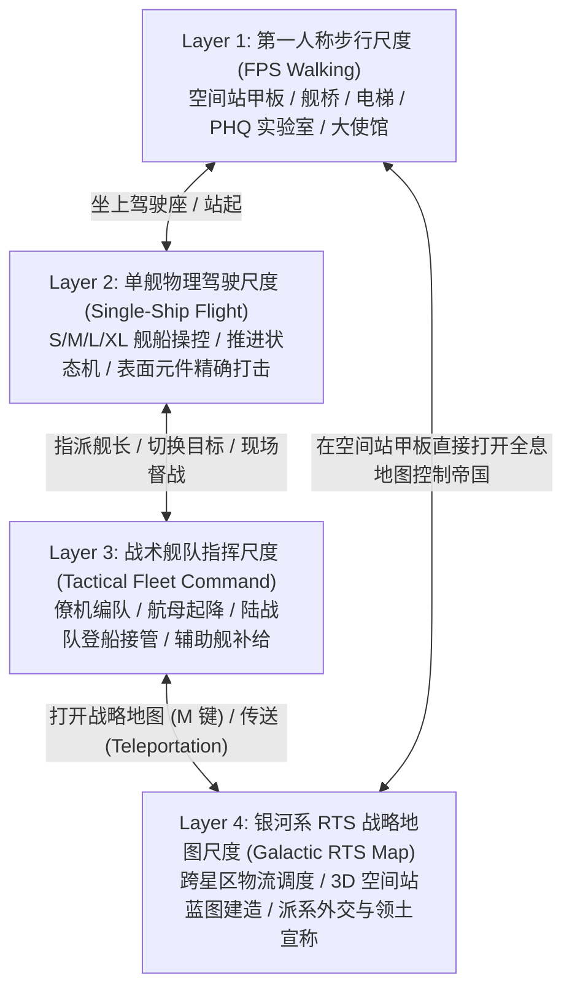
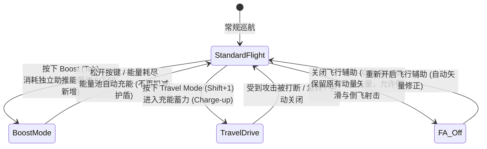
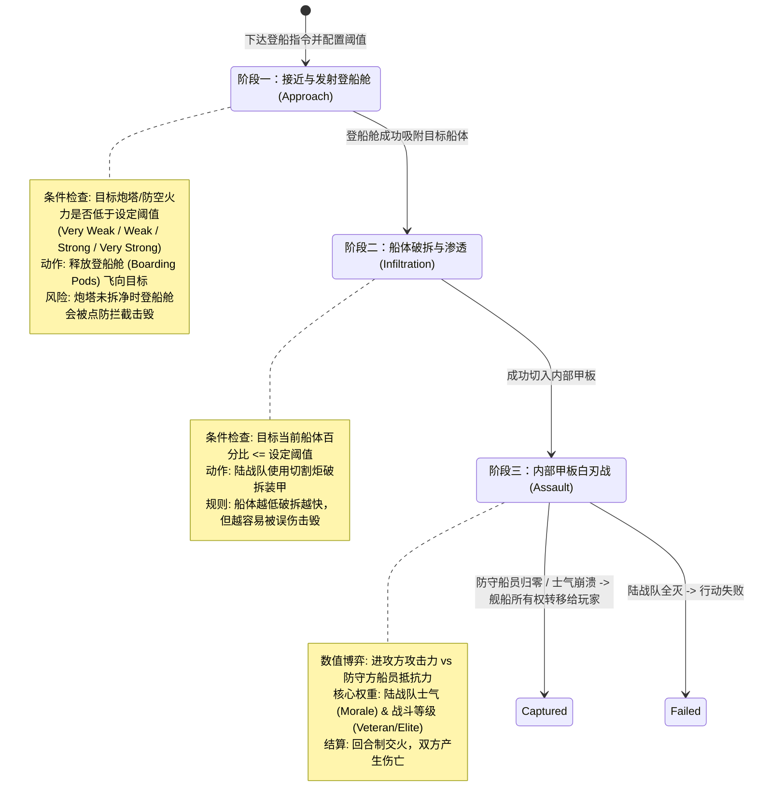

# 《X4：基石 (X4: Foundations)》深度系统架构与沙盒经济研究报告（AI Agent 专用结构化参考手册）

> **文档元信息 (Document Metadata)**
> - **目标受众**: 自动化规划 Agent、游戏系统架构师、沙盒经济模拟研究者
> - **事实基准版本**: 涵盖 1.0 基础版至 **8.00「外交更新 (Diplomacy Update)」** 及 **7.50「飞行模型更新 (Flight Model Update)」**、**7.00「存在危机 (Existential Crisis)」**，包含全部大型扩展包（*Split Vendetta*、*Cradle of Humanity*、*Tides of Avarice*、*Kingdom End*、*Timelines*）及小型内容包（*Hyperion Pack*、*Envoy Pack*）。
> - **核心范式**: 全实体化动态经济 (Physicalized Dynamic Economy) + 双层注意力模拟 (High/Low Attention Simulation) + 四层嵌套无缝尺度循环 (Multi-Scale Seamless Loop)。

---

## 第一部分：核心玩法与全模拟沙盒系统深度拆解

### 第 1 章 版本演进基线与核心设计哲学

#### 1.1 版本演进与 DLC 内容矩阵

《X4：基石 (X4: Foundations)》由 Egosoft 开发并持续迭代。截至 8.00 版本，游戏通过免费大版本更新与扩展包 (DLC) 构建了一个涵盖六大主要种族经济体与政治实体的沙盒宇宙。Agent 在解析游戏规则时，必须明确不同 DLC 引入的机制边界：

| 版本 / DLC 名称 | 发布时间节点 | 核心系统增量 (System Delta) | 新增派系 / 关键实体 | 对沙盒架构的结构性影响 |
| :--- | :--- | :--- | :--- | :--- |
| **Base Game (1.0 - 6.x)** | 2018.11 起 | 实体化货物经济、3D 模块化空间站、IS/OOS 双层模拟、PHQ 研究与传送 | Argon (ARG/ANT), Paranid (PAR/HOP), Teladi (TEL/MIN), Xenon (XEN), Kha'ak (KHK), Pirates (SCA/HAT) | 确立“无魔术刷怪”的通用联邦经济闭环与沙盒战争消耗模型 |
| **Split Vendetta** | 2020.03 | 北部星区扩张、高机动高爆发武器与引擎体系 | Zyarth Patriarchy (ZYA), Free Families (FRF), Fallen Families (FAF) | 加剧北部 Xenon 前线战损消耗，引入极端不平衡的船体/引擎取舍 |
| **Cradle of Humanity** | 2021.03 | 太阳系星区、**地球人简化经济 (Terran Economy)**、地球化改造终局前置条件 | Terran Protectorate (TER), Segaris Pioneers (PIO), Yaki (YAK) | 引入第二套平行工业树，极大降低新手/中后期自给自足的供应链节点复杂度 |
| **Tides of Avarice** | 2022.03 | **废料回收 (Scrap Recycling)**、**闭环制造 (Closed Loop)**、恒星潮汐环境危害 | Vigor Syndicate (VIG), Riptide Rakers (RIP) | 打通“战损残骸 -> 基础建材”的逆向物流闭环，引入食物/违禁品垄断冲突 |
| **Kingdom End** | 2023.04 | 博朗族湿式科技模块、孤立星门网络重连、电弧/控制类武器 | Queendom of Boron (BOR) | 补全经典全种族生态；新增需要特殊水体资源与护盾协同的舰船架构 |
| **7.00 & Timelines** | 2024.06 | **存在危机 (Existential Crisis)** 终局开关、经典舰船重制、独立战役解锁沙盒奖励 | 独立剧本解锁实体（如 *Xperimental Shuttle*） | 为资产超标（约 5 亿信用点以上且偏重军事资产）的后期帝国提供可控的高压消耗事件 |
| **7.50 Flight Model & Hyperion Pack** | 2025.02 | **重构飞行物理模型**（前 *Star Citizen* 物理程序员 John Pritchett 参与）、独立助推能量池、HUD 速度矢量指示器 | 传奇舰船 *Hyperion* 及专属开局 | 解除助推 (Boost) 与护盾的强耦合，引入基于质量/货物载重的惯性漂移 (Drift) |
| **8.00 Diplomacy & Envoy Pack** | 2025.09 | **外交系统 (Diplomacy)**、PHQ **大使馆 (Embassy Room)**、**特工 (Agents)** 雇佣与间谍干涉 | 隐形外交护卫舰 *Envoy*、海盗变体 *Cypher* | 首次允许玩家通过非军事手段（特工潜伏、挑拨离间、蓝图窃取）主动改写 AI 派系间的外交关系矩阵 |

#### 1.2 四层嵌套无缝尺度循环 (4-Tier Nested Seamless Loop)

X4 的核心设计哲学在于消除传统太空游戏中“FPS 步行”、“空间模拟飞行”与“4X/RTS 战略地图”之间的割裂感。玩家（及模拟中的状态切换逻辑）可以在四个尺度间实现**零加载界面 (Zero Loading Screen)** 的实时嵌套切换：

**对 Agent 理解的关键架构规则**：
1. **实体连续性 (Entity Continuity)**：玩家站在空间站停机坪上看到的降落货船，与战略地图上的一个蓝色图标是**同一个实体对象**。玩家随时可以走上该货船的舰桥，接管 NPC 舰长的位置亲自驾驶，或者站在舰桥后方让 AI 舰长执行自己的指令队列。
2. **控制权解耦 (Control Decoupling)**：玩家并非“舰船本身”，而是“拥有最高权限的指挥官意识”。通过**传送 (Teleportation)** 研究，玩家意识可以在物理上跨越星区瞬间转移到任何自有舰船或空间站（包括 8.00 的大使馆），从而将战略层决策与战术层微操无缝缝合。

---

### 第 2 章 实体化动态经济与供应链闭环

#### 2.1 “无魔术刷怪 / 全实体制造”原则及例外边界

X4 沙盒经济的基石是**货物经济 (Ware Economy)** 的绝对实体化。在常规星区（非 Kha'ak 特殊机制与少数剧本事件外），**宇宙中没有任何一艘正规派系舰船或空间站是凭空刷出来的**。

* **全实体制造法则 (Physicalized Manufacturing Rule)**：
  * 任何 AI 派系（包括敌对的 Xenon）想要建造一艘驱逐舰或一架战斗机，其**造船厂 (Shipyard)** 或**船坞 (Wharf)** 的仓储模块中必须物理性地拥有对应数量的原材料（如船体部件、武器组件、引擎组件等）。
  * 如果某个派系的矿船被截杀，导致其造船厂缺货，该派系的造船队列就会**无限期停滞 (Stalled)**，前线战损无法得到补充，最终导致领土被敌对派系吞噬。
* **系统例外边界 (Exception Boundaries)**：
  1. **Kha'ak 虫族生成机制**：Kha'ak 没有常规造船厂与经济供应链，其舰船基于星区采矿活跃度热力图，由**Kha'ak 前哨站 (Outpost)** 直接空间跃迁/生成在矿船附近（详见第 5 章）。
  2. **海盗派系生成补丁**：部分无固定领土的海盗（如 Scale Plate Pact, SCA）在缺乏完整造船厂支持时，存在受限的后台补给/伪装刷新逻辑，但其舰船仍可被玩家登船捕获并拆解为实体经济资源。
  3. **初始宇宙快照 (Universe Seed)**：开局时宇宙预设了基础空间站与初始舰队，以启动第一轮采集-生产循环。
  4. **空间站自动补给无人机与质量交通 (Mass Traffic)**：空间站周围的小型民用飞船群属于视觉/治安事件载体，不占用实质仓储体积。

#### 2.2 三大平行经济体系对比

随着 DLC 演进，X4 形成了三套互有交集但底层生产树截然不同的经济体系：

| 经济体系名称 | 适用派系 / 适用范围 | 工业树深度 | 核心终端建材 / 造船耗材 | 体系优劣势分析 (Agent 决策权重) |
| :--- | :--- | :--- | :--- | :--- |
| **通用联邦经济 (Universal / Commonwealth)** | ARG, ANT, PAR, HOP, TEL, MIN, ZYA, FRF, BOR | **极深（4~5 级）** | 船体部件 (Hull Parts)、电子元件 (Claytronics)、先进电子元件、武器/炮塔/护盾/引擎组件等 10+ 种高科技品 | **优势**：单位产品利润率极高，各种族互通性强； **劣势**：供应链极长，极易因单一中间品（如反物质电池或量子管）短缺引发全线雪崩 |
| **地球人经济 (Terran Economy)** | TER, PIO（需 *Cradle of Humanity*） | **极简（2~3 级）** | **电子计算基板 (Computronic Substrate)**、**碳化硅 (Silicon Carbide)**、金属微格 (Metallic Microlattice) | **优势**：完全跳过中间精炼品，直接由原矿/气体+能量电池合成终极组件，抗断链能力极强； **劣势**：单次循环对原矿（硅、矿石、氢、氦、甲烷）吞吐量极大，对采矿船队规模要求极高 |
| **闭环经济 (Closed Loop)** | 玩家空间站/船厂可选全局或单站配置（需 *Tides of Avarice*） | **极简（3 种核心输入）** | **能量电池 (Energy Cells)**、**船体部件 (Hull Parts)**、**电子元件 (Claytronics)** | **优势**：建造空间站和**Argon 规格舰船/通用装备**时，完全免除武器/护盾/引擎/导弹等微组件需求；与废料回收完美闭环； **劣势**：无法直接用于建造非 Argon 的其他种族专属船体与武器（仍需对应组件） |

*(注：Xenon 拥有独立的极简机械经济，仅消耗矿石 Ore、硅 Silicon 与能量电池 Energy Cells 即可在 Xenon 船坞/造船厂直接打印舰船与空间站。)*

#### 2.3 通用联邦全链条生产依赖表

以下为《X4》通用联邦经济从原材料到终极战争消耗品的完整有向无环图 (DAG) 核心依赖结构：

| 层级 (Tier) | 货物类别 | 货物英文原名 (中文译名) | 仓储类型 (Storage Type) | 直接上游输入依赖 (Inputs) | 下游核心去向 (Consumers) |
| :--- | :--- | :--- | :--- | :--- | :--- |
| **Tier 0** | 采集原矿 | **Ore** (矿石) | 固体 (Solid) | 小行星带采集 | Refined Metals, Teladianium |
| **Tier 0** | 采集原矿 | **Silicon** (硅) | 固体 (Solid) | 小行星带采集 | Silicon Wafers |
| **Tier 0** | 采集原矿 | **Ice** (冰) | 固体 (Solid) | 冰带采集 | Water |
| **Tier 0** | 采集原矿 | **Nividium** (尼维迪乌姆) | 固体 (Solid) | 稀缺小行星采集 | 贸易站倾销、PHQ 传送研究/地球化改造 |
| **Tier 0** | 采集气体 | **Hydrogen** (氢) | 液体 (Liquid) | 星云气体采集 | Antimatter Cells |
| **Tier 0** | 采集气体 | **Helium** (氦) | 液体 (Liquid) | 星云气体采集 | Superfluid Coolant |
| **Tier 0** | 采集气体 | **Methane** (甲烷) | 液体 (Liquid) | 星云气体采集 | Graphene |
| **Tier 0** | 恒星能源 | **Energy Cells** (能量电池) | 集装箱 (Container) | 太阳能板免费生产（受星区日照率 `Sunlight %` 影响） | **全宇宙所有生产与建造模块** |
| **Tier 1** | 初级精炼 | **Refined Metals** (精炼金属) | 集装箱 (Container) | Ore + Energy Cells | Hull Parts, Engine Parts, Scanning Arrays |
| **Tier 1** | 初级精炼 | **Teladianium** (泰拉迪合金) | 集装箱 (Container) | Ore + Energy Cells（Teladi 专属替代） | Teladi 变体 Hull Parts / 建筑 |
| **Tier 1** | 初级精炼 | **Silicon Wafers** (硅晶圆) | 集装箱 (Container) | Silicon + Energy Cells | Microchips, Smart Chips, Scanning Arrays |
| **Tier 1** | 初级精炼 | **Graphene** (石墨烯) | 集装箱 (Container) | Methane + Energy Cells | Hull Parts, Quantum Tubes, Claytronics |
| **Tier 1** | 初级精炼 | **Superfluid Coolant** (超流体冷却剂) | 液体/集装箱 (输出为 Container) | Helium + Energy Cells | Quantum Tubes, Shield/Turret Components |
| **Tier 1** | 初级精炼 | **Antimatter Cells** (反物质电池) | 集装箱 (Container) | Hydrogen + Energy Cells | Engine/Weapon/Missile Components, Claytronics |
| **Tier 1** | 生命维持 | **Water** (水) | 集装箱 (Container) | Ice + Energy Cells | 各类种族食物（Food Rations 等）、医疗用品、电子元件辅助 |
| **Tier 2** | 中级组件 | **Hull Parts** (船体部件) | 集装箱 (Container) | Refined Metals + Graphene + Energy Cells | **空间站建造、所有舰船船体、维修** |
| **Tier 2** | 中级组件 | **Microchips** (微芯片) | 集装箱 (Container) | Silicon Wafers + Energy Cells | Claytronics, Advanced Electronics, Field Coils |
| **Tier 2** | 中级组件 | **Quantum Tubes** (量子管) | 集装箱 (Container) | Graphene + Superfluid Coolant + Energy Cells | Claytronics, Advanced Composites, Shield Components |
| **Tier 2** | 中级组件 | **Smart Chips** (智能芯片) | 集装箱 (Container) | Silicon Wafers + Energy Cells | 无人机、导弹、诱导弹、引导部件 |
| **Tier 2** | 中级组件 | **Engine Parts** (引擎部件) | 集装箱 (Container) | Refined Metals + Antimatter Cells + Energy Cells | 舰船推进引擎制造 |
| **Tier 3** | 高科技终端 | **Claytronics** (电子元件) | 集装箱 (Container) | Antimatter Cells + Microchips + Quantum Tubes + Energy Cells | **几乎所有空间站模块建造的核心瓶颈物资** |
| **Tier 3** | 高科技终端 | **Advanced Electronics** (先进电子元件) | 集装箱 (Container) | Microchips + Quantum Tubes + Energy Cells | 高级炮塔、武器、卫星、飞船核心 |
| **Tier 3** | 高科技终端 | **Weapon / Turret / Shield Components** | 集装箱 (Container) | 对应的 Hull Parts / Quantum Tubes / Microchips / Plasma Conductors 等组合 | **船坞 (Wharf) 与造船厂 (Shipyard)** 装配耗材 |

#### 2.4 经济消耗槽 (Economic Sink) 闭环机制

在沙盒经济中，如果只有生产没有消耗，所有仓库最终都会爆仓并导致价格归零（经济死锁）。X4 通过四层消耗槽维持动态平衡：

1. **核心消耗槽：派系战争战损 (Faction War Attrition)**
   * 各派系存在预设的“目标舰队规模 (Desired Fleet Quota)”。当 Xenon 摧毁 Argon 的驱逐舰，或 HOP 与 PAR 在边界交火损毁战斗机时，AI 派系的造船逻辑会立即向其**船坞 (Wharf，负责 S/M 级舰船)** 与**造船厂 (Shipyard，负责 L/XL 级舰船)** 下达建造订单。
   * 建造订单直接消耗仓库中的船体部件、引擎/武器/护盾/炮塔组件与先进电子元件，进而拉动上游矿产与中间品需求。
   * *设计洞察*：如果玩家彻底消灭了 Xenon 并促成全宇宙和平（或通过 8.00 外交消除所有冲突），全宇宙经济会迅速陷入通缩与停滞。
2. **次级消耗槽：空间站劳动力维持 (Workforce Consumption)**
   * 空间站居住区 (Habitat) 中的工人每小时持续消耗**种族食物 (Food)** 与**医疗用品 (Medical Supplies)**，属于不可逆的纯粹消耗。
3. **逆向补充与回收槽：废料回收 (Scrap Economy)**
   * 战场上被摧毁的 L/XL 舰船与空间站残骸可被拖船（如 *Teuta*）分解为残骸块，由打捞船（如 *Manticore*）拖回**废料处理器 (Scrap Processor)** 转化为废金属 (Scrap Metal)，再由**废料回收器 (Scrap Recycler)** 消耗巨量能量电池转化为 **Hull Parts** 和 **Claytronics**。
4. **终局资源黑洞：地球化改造 (Terraforming)**
   * 后期玩家动辄需要向行星投放数百万单位的能量电池、食物、电子元件、水与冰，人为制造超级需求缺口。

#### 2.5 价格发现、订单预留与动态撮合算法

X4 的贸易系统并非固定物价，而是由每个空间站逻辑概览内部独立运行的**库存水位定价函数 (Storage-Level Pricing Function)** 驱动：

1. **库存水位线性定价区间**：
   * 每种货物在游戏内均设有全局基准的最低价 $P_{\min}$、平均价 $P_{\text{avg}}$ 与最高价 $P_{\max}$。
   * 空间站对该货物的即时报价由当前库存占分配仓储上限的比例 $S \in [0, 1]$ 决定：当资源作为**输入原料（买单）**时，库存越接近 $0\%$，买价越趋近于 $P_{\max}$；当资源作为**输出成品（卖单）**时，库存越接近 $100\%$，卖价越趋近于 $P_{\min}$。
   * 空间站经理会根据库存情况自动调整价格，玩家亦可手动锁定固定价格以强制控制利润率或吸引外部货船。
2. **交易订单预留锁 (Trade Reservation Lock)**：
   * 为防止多艘 AI 货船同时冲向同一个高利润买单导致“后到者扑空（货仓已被填满）”，X4 在交易撮合阶段引入了**物理预留机制 (Ware Reservation)**。
   * 当一艘货船决定执行某笔交易时，系统立即在目标空间站的逻辑库存中扣除或预留对应的配额（在界面中显示为虚线或预留量），其他货船在计算利润时只能看到剩余未预留的净需求量。若该货船在中途被击毁或被玩家手动取消指令，预留锁自动释放。
3. **贸易站跨星区中继架构 (Trade Station Relay)**：
   * 由于单个空间站经理的最大辐射半径被限制在 $5$ 跳星门以内，跨越多达十几跳星区的远程供需无法直接撮合。
   * 高阶玩法与 AI 物流架构通常在枢纽星区建造仅含仓储与停机坪的**中继贸易站 (Trade Station)**，通过“低价买进、高价卖出”的阶梯定价与黑名单隔离，将全宇宙的物流网络拆解为多个互相接力的 5 跳局部网络。

---

### 第 3 章 空间站模块化建造与物流运营

#### 3.1 地块购买、建筑仓储与 3D 网格拼装

玩家或 AI 派系建造空间站遵循严格的空间与物理物流规则：

1. **地块购买 (Plot Purchase)**：
   * 在星区地图中划定一个长宽高可调的三维立方体空间（最大可达 $20\text{km} \times 20\text{km} \times 20\text{km}$）。
   * 若该星区属于某派系领土，玩家需向星区所有者支付**地块许可费 (Plot License Fee)**，费用随地块体积与距离核心航道/星门的接近程度呈非线性增长（无主星区或已由玩家宣称的星区免费）。
2. **建筑仓储 (Build Storage)**：
   * 空间站本体之外会自动生成一个独立的临时停靠平台，称为**建筑仓储 (Build Storage)**。
   * 建筑材料（Hull Parts、Claytronics、Energy Cells）**必须由货船运送到建筑仓储**，而非空间站主仓库。
   * 必须雇佣一艘 **XL 级建筑船 (Builder Ship)** 飞抵现场，派出建造无人机 (Construction Drones) 才能按模块顺序逐一施工（最多支持 30 架建造无人机同时加速，超过上限无额外加速）。
3. **3D 网格模块化拼装 (3D Grid Modular Assembly)**：
   * 空间站由功能各异的模块通过**连接节点 (Snap Points)** 自由旋转、拼接而成。核心模块分类如下：
     * **停机坪 (Dock Area)**：供 S/M 级舰船停靠（如 1M6S 标准停机坪、3M6S 豪华停机坪）。
     * **大型泊位 (Pier)**：供 L/XL 级舰船停靠（如单向 T 型泊位、三向 E 型泊位、四向十字泊位）。**架构铁律**：大型矿船与货船若无 Pier，只能依赖货运无人机 (Cargo Drones) 进行极低效的虚空转运，甚至完全卡死物流。
     * **仓储模块 (Storage Modules)**：严格区分三种物理形态——**集装箱仓储 (Container Storage)** 存放制成品与能量电池；**固体仓储 (Solid Storage)** 存放 Ore/Silicon/Ice/Nividium；**液体仓储 (Liquid Storage)** 存放 Hydrogen/Helium/Methane。三者不可混用。
     * **生产模块 (Production Modules)**：对应第 2 章各类货物工厂。
     * **居住区模块 (Habitation Modules)**：按种族划分（Argon, Teladi, Paranid, Split, Terran, Boron），提供工人容量。
     * **防御模块 (Defense Modules)**：碟形/桥式防御平台，可装配 L 级炮塔、M 级炮塔与护盾发生器；**行政中心 (Administrative Centre)** 属于特殊防御/管理模块，是宣称星区主权的核心实体。
     * **船坞/造船厂/维护湾 (Wharf / Shipyard / Equipment Dock)**：S/M 制造湾、L/XL 制造湾与装备维护模块。

#### 3.2 居住区与劳动力 (Workforce) 效率加成机制

空间站在零工人状态下仍能以 **100% 基础自动化效率** 运行。引入居住区并供应对应种族的食物与医疗用品后，劳动力人口会随时间逐步迁入，带来**纯免费的额外产出加成**。

* **线性缩放与零额外原料消耗法则**：
  * 设某生产模块所需最优劳动力为 $W_{\text{req}}$，当前空间站分配给该模块的劳动力比例为 $r = \min(1, \frac{W_{\text{avail}}}{W_{\text{total\_req}}})$，该模块的最大劳动力加成为 $B_{\max}$。
  * 实际产出倍率：
    $$M_{\text{output}} = 1.0 + r \cdot B_{\max}$$
  * **关键数值特性**：原材料输入量**保持 100% 不变**。即 $+50\%$ 的劳动力加成意味着消耗相同的矿石与能量电池，直接凭空多产出 $50\%$ 的成品，相当于极大幅度压缩了单位产出的矿产成本与空间站模块占地。
* **各层级模块典型最大加成范围 ($B_{\max}$)**：
  * 初级精炼品（Refined Metals, Graphene, Silicon Wafers）：约 **+20% ~ +30%**。
  * 高科技组件（Hull Parts, Claytronics, Advanced Electronics, Quantum Tubes）：约 **+35% ~ +60%**（例如 Quantum Tubes 与 Advanced Electronics 接近高区间）。
  * 地球人模块：加成曲线与基础循环时间经独立平衡，同样依赖 Terran 食物（MRE）与医疗用品维持。
  * 若食物或医疗用品断供，劳动力会持续流失，效率加成退回 0%。

#### 3.3 蓝图获取双路径：合法购买 vs EMP 信号泄露破解

在玩家建造任何模块之前，必须拥有对应的**蓝图 (Blueprint)**：
1. **合法购买**：在声望达到要求（通常 0 或 +10/+20）后，前往对应派系空间站的**派系代表 (Faction Representative)** 处花费信用点购买。*限制*：造船厂 (Shipyard)、船坞 (Wharf) 与部分终局模块蓝图价格极高（数千万至数亿信用点），且高阶军用模块有严格声望门槛。
2. **EMP 炸弹信号泄露扫描 (EMP Bomb Data Leak Scanning)**：
   * **操作流程**：玩家驾驶宇航服 (Spacesuit) 靠近目标空间站的特定模块，向模块表面发射一枚**电磁脉冲炸弹 (EMP Bomb)** 并远程引爆。
   * **结果**：爆炸会在模块表面生成 4 个**数据泄露点 (Data Leaks)**，同时短暂触发该空间站安保的敌意警告（通常不致死或仅小幅扣减局部临时关系）。
   * **收益**：使用宇航服扫描器贴近扫描这些泄露点，有极高概率直接免费解锁该生产模块/居住区/仓储/防御模块的**永久蓝图**。
   * **例外边界**：**船坞 (Wharf)、造船厂 (Shipyard) 及部分特殊派系总部模块无法通过 EMP 窃取**，必须合法购买；部分 8.00 新增外交/特工行动亦可辅助获取蓝图或情报。

#### 3.4 空间站经理 (Manager) 与自动物流调度

空间站的核心自动化大脑是**空间站经理 (Station Manager)**：
* **星级辐射半径公式**：
  * 空间站经理的管理星级（0 至 5 星，取决于管理技能 Management）直接决定附属矿船与货船的**最大星门跳跃范围 (Max Gate Jumps)**：
    $$\text{Max Jumps} = \lfloor \text{Manager Stars} \rfloor$$
  * 即 1 星经理只能在本星区及相邻 1 跳星区买卖/采矿；5 星经理可覆盖 5 跳星区半径内的所有星系。
* **附属舰船自动化分配**：
  * **为指挥官采矿 (Mine for Commander)**：AI 矿船自动扫描经理覆盖范围内的资源点，采集空间站所需原材料并卸货。
  * **为指挥官贸易 (Trade for Commander)**：AI 货船自动从“逻辑概览 (Logical Overview)”中读取原料缺口（买单）与成品溢余（卖单），在价格区间内跨星区撮合交易。
  * **为建筑仓储贸易 (Trade for Commander's Build Storage)**：专门负责向建造中的空间站工地运送建材。

#### 3.5 贸易规则 (Trade Rules)、黑名单 (Blacklists) 与重复指令 (Repeat Orders)

为了防止 AI 货船/矿船闯入 Xenon 占领区送死或将紧缺原料低价卖给敌对派系，玩家必须配置全局或单站级的规则矩阵：

* **黑名单 (Blacklists)** 三大维度：
  1. **星区行进黑名单 (Sector Travel)**：禁止船只飞越特定高危星区（如 Xenon 核心区或恒星潮汐区）。
  2. **星区活动黑名单 (Sector Activities)**：允许路过（使用高速公路），但禁止在该星区停靠、采矿或交易。
  3. **贸易禁令 (Trade Restrictions)**：禁止与特定派系进行任何交易。
* **贸易规则 (Trade Rules)**：
  * 可精确控制某件货物“**仅限内部派系交易 (Restrict all factions except Player)**”。这是构建**自给自足超级联合体 (Mega-Complex)** 或**内循环供应链**的核心开关——确保自产的 Hull Parts 优先供给自家船厂而非被 NPC 买空。
* **重复指令 (Repeat Orders)**：
  * 需要飞行员至少 **1 星**。允许玩家手动录制一条确定性的指令环（例如：`在 A 站买入能量电池 -> 在 B 站卖出 -> 在 C 点部署卫星`），船只会无限循环执行，绕过经理星级与动态定价的模糊性，常用于精确补给、跨星区远距离倒卖或自动抛货。

#### 3.6 空间站无人机调度与物流防死锁规范

空间站自身不具备移动能力，其对外物理交互与自卫高度依赖**自动化无人机集群 (Station Drones)**：
1. **货运无人机 (Cargo Drones)**：
   * 当缺乏大型泊位 (Pier) 的空间站与 L/XL 舰船交易时，或建筑仓储向主体施工区转运建材时，必须依赖货运无人机进行虚空往返搬运。
   * **工程瓶颈警示**：由于无人机飞行速度极慢且在高关注度 (IS) 模式下易发生物理排队拥堵，未配备大型泊位与足够货运无人机的空间站会导致 L 级货船在站外停滞数十分钟，进而拖垮整条生产线的物流周转率。
2. **维修无人机 (Repair Drones) 与防御无人机 (Defense Drones)**：
   * 维修无人机在空间站模块或炮塔受损时自动出舱进行物理焊修，不额外消耗建造材料；防御无人机则在空间站遭受攻击时批量弹射以拦截敌方 S 级战机群，但自身损耗后需消耗无人机组件或智能芯片补充。
3. **建造队列并发与排序规则**：
   * 同一座空间站同一时间仅能绑定一艘 XL 建筑船施工，无法通过多艘建筑船并联加速。因此，玩家与 AI 在规划大型超级联合体时，必须遵循“**先停机坪与泊位 -> 再仓储与太阳能 -> 最后生产与居住区**”的拓扑建造顺序，确保首阶段物流设施完工后即可立即接管后续建材运输，避免工地死锁。

---

### 第 4 章 舰船分类、装配系统与战斗/登船机制

#### 4.1 S/M/L/XL 舰船分级与停靠拓扑

X4 将所有太空舰船严格划分为四个物理尺寸等级，直接决定了停靠兼容性、引擎架构与战斗定位：

| 级别 | 典型舰种 | 停靠需求 | 推进与护盾特征 | 表面元件可破坏性 | 舰内空间与交互 |
| :--- | :--- | :--- | :--- | :--- | :--- |
| **S (Small)** | 侦察机 (Scout)、战斗机 (Fighter)、重型战斗机 (Heavy Fighter) | 1M6S / 航母 S 停机坪 | 1 个 S 级引擎、1~3 个 S 级护盾；极高转向与加减速 | **不可独立破坏**（整体血量与护盾模型） | 仅驾驶舱，无内部走道（部分特殊船除外） |
| **M (Medium)** | 护卫舰 (Corvette)、护卫炮艇 (Frigate)、中型矿船/货船 | 1M6S / 3M6S / 航母 M 停机坪 | 1~2 个 M 级引擎、1~3 个 M 级护盾；可搭载 S 级停机坪（如 Frigate） | **不可独立破坏**（炮塔可被常规火力压制但无独立元件槽） | 拥有驾驶舱、走廊与小型停机坪（如炮艇可停 1 架 S 船） |
| **L (Large)** | 驱逐舰 (Destroyer)、大型矿船/货船、部分特殊炮舰 | **大型泊位 (Pier)** 或货运无人机虚空转运 | 多台 L 级主引擎、L 级主护盾；配备主炮与大量 M/L 炮塔 | **完全支持表面元件独立瞄准与摧毁** | 拥有大型舰桥、传送门与部分舰员甲板 |
| **XL (Extra-Large)** | 航母 (Carrier)、战列舰 (Battleship，如 *Asgard* / *Erlking*)、辅助补给舰 (Auxiliary)、建筑船 (Builder) | **大型泊位 (Pier)** | 多台 XL 级引擎、多层 XL 护盾；航母内置大规模 S/M 机库与起降甲板 | **完全支持表面元件独立瞄准与摧毁**；拥有独立元件护盾 | 拥有宏伟舰桥、内部机库甲板、起降跑道 |

#### 4.2 推进系统状态机与 v7.50 飞行物理模型

在 **7.50「飞行模型更新」** 后，X4 的飞行物理经历了彻底重构，推进系统表现为四态互斥/切换的状态机：

**v7.50 物理重构核心工程变化**：
1. **助推与护盾解耦 (Boost-Shield Decoupling)**：7.50 之前，开启 Boost 会直接消耗舰船护盾值，导致护卫战中极少使用助推；7.50 引入**独立助推能量池 (Dedicated Boost Energy Pool)**，使得狗斗机动、规避导弹与紧急脱离成为高频常规操作。
2. **质量与货物惯性 (Mass & Cargo Inertia)**：满载矿石的 L 级矿船与空载状态拥有截然不同的制动距离与转向漂移 (Drift)，直接影响高关注度 (IS) 下的自动避障路径规划。
3. **种族引擎特性分化**：
   * **地球人 (Terran)**：巡航驱动 (Travel Drive) 蓄力极快、起步加速迅猛，但极速一般。
   * **帕拉尼德 (Paranid)**：极高的巡航极速，但高速下转向灵巧度大幅下降。
   * **斯普利特 (Split)**：常规战斗速度全宇宙最快，配合漂移特性适合高速掠袭。

#### 4.3 表面元件 (Surface Elements) 独立破坏模型

L 与 XL 级大型舰船并非单一的“血条盒子”，而是由**主船体 (Hull)**、**主护盾 (Main Shields)** 与挂载在 3D 表面上的**表面元件 (Surface Elements)** 构成的复合实体：
* **可独立摧毁的子系统**：
  1. **引擎 (Engines)**：摧毁全部主引擎后，L/XL 舰船速度归零（无法进入巡航或转向），彻底丧失机动能力，成为活靶子或登船目标。
  2. **炮塔 (Turrets)**：按区域分布（如左舷、右舷、腹部防空、反舰 L 级等离子炮塔），可逐一精准点杀以形成“火力盲区”。
  3. **护盾发生器 (Shield Generators)**：包括保护主船体的主护盾发生器，以及专门保护炮塔/引擎群的**元件护盾 (Surface Element Shields)**。
* **修复机制**：L/XL 舰船配备的**维修无人机 (Repair Drones)** 与船员中的**工程兵 (Service Crew)** 会在脱战或交战期间持续缓慢修复受损的表面元件与船体（船体通常仅能修复至特定上限如 70%~90%，完全修复需前往船坞或辅助舰）。

#### 4.4 陆战队登船接管 (Boarding) 三阶段状态机

由于 X4 遵循“全实体制造”，直接通过登船捕获一艘价值数千万的 L/XL 级驱逐舰或建筑船是前中期最高效的资本积累手段。登船行动通过**登船选项 (Boarding Options)** 面板配置阈值，底层运行一个严格的三阶段状态机：

**核心博弈启发式规则**：
* **零声望惩罚白嫖法则**：攻击正规派系（如 ARG/TER）并射出登船舱会立即触发剧烈声望暴跌与警报；但攻击伪装成海盗的派系（如 SCA 掠夺者驱逐舰）或无主中立目标，**不会扣除任何正规派系声望**。
* **士气与星级压倒数量**：50 名 0 星新兵 (Recruit) 的登船战力远不如 20 名 3~5 星老兵 (Veteran/Elite)；先拆光目标引擎、炮塔与护盾（将 Phase 1 与 Phase 2 设为 `Weak / Weak` 或 `Very Weak`），并将船体压低至 $40\% \sim 60\%$，是零战损捕获的标准工程流程。

#### 4.5 玩家总部 (PHQ) 与传送研究树

玩家在游戏早期通过 Boron 科学家 **Boso Ta** 的任务线获得独一无二的**玩家总部 (Player Headquarters, PHQ)**——一座围绕巨型小行星建造的模块化科研基地。
* **研究树 (Research Tree)** 核心分支：
  1. **常规传送 (Teleportation)**：从 1 跳星区逐步解锁至全银河系任意己方资产瞬间传送。
  2. **飞船改装 (Ship Modifications)**：解锁工作台，消耗战利品材料对引擎、武器、护盾、船体进行属性词条洗练（如减少质量、增加冷却、提升装填）。
  3. **高能质量传送 (High-Mass Teleportation I & II)**：
     * **等级 I**：允许将整座 PHQ 空间站（连同其上建造的所有生产模块与停靠舰船）瞬移至**同一星区**内的导航信标 (Nav Beacon) 处。
     * **等级 II**：允许将整座 PHQ 瞬移至**全宇宙任意星区**的导航信标处。每次跳跃均需消耗巨量资源（能量电池、先进电子元件、Nividium、场线圈等），是开启后期**地球化改造 (Terraforming)** 的强制前置科技。
  4. **外交大使馆 (8.00 新增)**：解锁 PHQ 内部的大使馆房间，用于召集各派系代表并调度特工。

#### 4.6 弹药后勤、消耗品与船员技能成长曲线

1. **能量武器与实体消耗品分化**：
   * 常规脉冲激光、等离子炮与电弧武器仅受**武器热量 (Weapon Heat)** 限制，不消耗实体弹药，冷却后即可无限开火。
   * **导弹 (Missiles)、鱼雷 (Torpedoes)、诱导弹 (Countermeasures)、激光塔 (Laser Towers) 与卫星 (Satellites)** 均属于严格实体消耗品，耗尽后必须返回船坞、装备维护站或由辅助舰装填，直接影响轰炸机编队的持续作战半径。
2. **船员五维技能与非线性成长瓶颈**：
   * 游戏内所有 NPC 船员拥有五项核心属性：**驾驶 (Piloting)**、**管理 (Management)**、**登船 (Boarding)**、**工程 (Engineering)** 与 **士气 (Morale)**，星级范围均为 $0 \sim 5$ 星。
   * **经验衰减壁垒**：船员通过日常自动采矿、贸易或战斗可稳定提升至 $2 \sim 3$ 星，但从 $3$ 星向 $4$ 星、$5$ 星的自然成长极其缓慢。若需批量解锁高级自动贸易（要求 3 星驾驶）或极高效率空间站经理，必须依赖任务奖励的**技能研讨会教材 (Seminars)**、建造**地球化改造训练设施**或利用空间站经理在海量交易流水下的高频经验结算曲线。

---

### 第 5 章 派系政治、AI 模拟分层与终局系统

#### 5.1 High Attention (IS) 与 Low Attention (OOS) 双层模拟机制

为了在单机 CPU 上同时实时演算数千座空间站与数万艘舰船的物理与经济行为，X4 采用了动态的**双层注意力模拟架构 (Dual-Layer Attention Simulation)**。传统玩家常沿用前作术语称其为 **IS (In-Sector，星区内)** 与 **OOS (Out-of-Sector，星区外)**，但在 X4 底层引擎中，切换边界实际上是一个以玩家/当前观察视角为中心的**约 100 km 动态球形气泡**：

| 模拟维度 | High Attention (IS / 玩家气泡内) | Low Attention (OOS / 玩家气泡外) | 对实战与帝国运营的工程影响 |
| :--- | :--- | :--- | :--- |
| **物理碰撞与避障** | **全 3D 物理碰撞开启**。大型舰船需绕开小行星、空间站与友军，极易因寻路拥堵而原地转向浪费时间 | **碰撞物理完全关闭**。舰船沿数学矢量平滑直线穿越障碍物与空间站模型 | L/XL 舰船在 OOS 下移动、进出星门与编队效率远高于 IS |
| **弹道与命中判定** | 每一发子弹、导弹与激光均为**物理投射物**，需与 3D 碰撞盒真实相交；高速战机可通过机动闪避 | **无实体弹道**。通过统计学的 DPS 期望、追踪速度、目标尺寸与随机数 (RNG) 周期性直接扣血 | 高速高闪避轻型战机在 OOS 下面对重火力时存活率可能骤降 |
| **炮塔开火机制** | 炮塔根据自身转速与射界持续物理追踪并全速倾泻火力 | 为防止炮塔舰船在纯数学结算中过度碾压，**炮塔在每次结算 Tick 中仅有约 30% 的概率触发开火** | **“Xenon K 悖论”**：极度依赖炮塔的资本舰在 OOS 下输出大幅缩水，易被 50 架 S 级战机围杀；但玩家一旦传送进场 (IS)，炮塔全开加上死亡爆炸冲击波会瞬间团灭战机群 |
| **死亡爆炸伤害** | 舰船/空间站摧毁时产生**物理冲击波**，对周围近距离小船造成连锁毁灭 | 无物理范围溅射伤害 | 玩家近距离指挥航母编队时需警惕敌方主力舰自爆波及己方舔包/近战机群 |
| **采矿与停靠效率** | 矿船需飞近实体小行星、发射采矿激光并物理拾取掉落矿块；货船需排队对接停机坪 | **无实体小行星与排队动画**。采矿速率直接按区域资源密度与船员星级公式结算；交易到达即瞬时完成 | **核心优化准则**：玩家应尽量远离自己的核心工业星区（保持工业区处于 LA/OOS 状态），以最大化采矿与物流吞吐量并保障帧率 |

#### 5.2 领土宣称、声望梯度与 8.00 外交干涉系统

* **领土宣称规则 (Territory Claiming)**：
  * 星区所有权并非永久固定。任何派系（包括玩家）只要在目标星区建造一座带有**行政中心 (Administrative Centre)** 模块的防御站（或造船厂/船坞），且该星区内**没有其他敌对/原有主权派系的行政中心**，星区主权即归属于该建造者。
  * 若存在多个派系的行政中心，星区处于“争夺状态 (Contested)”，需摧毁竞争对手的全部行政中心方可完成易主。
* **声望梯度机制 (-30 到 +30 精确阈值)**：
  声望采取非对称非线性增长（从 0 升至 +10 极其容易，从 +20 升至 +30 需要海量交易量或高难任务）：

| 声望区间 / 阈值 | 政治状态标签 | 权限解锁 / 行为规则变化 |
| :--- | :--- | :--- |
| **-30** | **死敌 (Arch-Enemy)** | 全星系无差别击杀所有玩家资产；8.00 外交界面主动宣战会直接锁定为 -30 |
| **-25 ~ -20** | **全面敌对** | 敌方巡逻队、军事舰队主动跨区域猎杀玩家舰船 |
| **-10** | **敌对门槛 (Enemy)** | 跨过 -9 降至 -10 时，**丧失所有该派系空间站的停靠权限**，民用船只标红 |
| **-9 ~ +9** | **中立 (Neutral)** | 允许停靠与基础贸易，可购买民用船只与基础货物 |
| **+10** | **友好门槛 (Friend / 一级晋升)** | 派系代表发出邀请，解锁**基础军用执照**、标准战斗舰船蓝图与中级武器装备 |
| **+20** | **盟友门槛 (Ally / 二级晋升)** | 解锁**高级主力舰 (L/XL) 蓝图与执照**、顶级组件及高价值军事任务 |
| **+27 ~ +30** | **亲密盟友 (Close Ally)** | 享受最高贸易折扣，满足部分终局外交与剧情最高信任门槛 |

* **8.00 外交更新：大使馆与特工系统**：
  * **大使馆 (Embassy Room)**：位于 PHQ 内，各派系代表围绕圆桌聚集，提供集中的全局派系关系与政治总览界面。
  * **特工 (Agents)**：玩家可雇佣专精谈判或间谍行动的 NPC 特工（初始上限 2 名，通过研究与进度最高可扩展至 8 名），将其指派至专用舰船（如 *Envoy*）执行任务：
    * **关系修复/恶化**：直接干预并修改第三方派系之间的外交关系（例如在两个原本和平的派系间制造摩擦引发全面战争，从而人为拉动军火市场需求）。
    * **间谍与窃密**：渗透敌对目标，窃取蓝图或获取军事情报。

#### 5.3 Xenon 扩张与 Kha'ak 采矿热力图机制

宇宙中两大常驻威胁采用完全不同的底层生成逻辑：
1. **Xenon（机械智能体）**：
   * 完全遵循沙盒经济规则，拥有自己的矿船（*SE* 等）与能量/矿石供应链。
   * 当其前线星区矿产充足时，Xenon 船坞会持续爆兵（K 级、I 级驱逐/战列舰）向外星门推进，并派遣建筑船抢占星区。切断其矿船补给或摧毁其船坞/造船厂即可从物理上瘫痪其扩张。
2. **Kha'ak（虫族）**：
   * 分为**大型蜂巢 (Kha'ak Hive)** 与**小型前哨站 (Kha'ak Outpost)** 两级结构。
   * **硬编码刷新位**：Hive 仅在特定预设星区（如 *Heretic's End*, *Matrix #451*, *Pious Mists IV* 等，**绝不出现在地球人 TER/PIO 与博朗 BOR 星区**）刷新，被摧毁后约 96 小时（4 天游戏时间）在另一有效位点重生。
   * **采矿热力图触发器 (Mining Heat Map)**：只要任何矿船在距离活跃 Hive **3 跳以内**的星区采集 **Ore、Silicon 或 Nividium**（冰与气体不触发），后台计数器就会累加。超过阈值后，系统在目标星区中心外围 **140 ~ 180+ km 甚至 Z 轴极高/极低处** 生成一座隐藏的 Outpost。
   * **虚空跃迁刷怪**：Outpost 存活期间，Kha'ak 战斗机与护卫舰不走星门，直接定期空降在正在采矿的矿船头顶。仅拆掉 Outpost 只能换取数小时安宁，必须摧毁 3 跳内的母巢 Hive 才能根治。

#### 5.4 终局系统：地球化改造 (Terraforming) 与存在危机 (Existential Crisis)

* **地球化改造 (Terraforming)**：
  * 玩家将 PHQ 传送至特定行星所在星区后，可启动行星生态改造工程（如调整大气、降温、引入水源、建立生物圈与居住城市）。
  * 每个阶段消耗天文数字级的资源（如数百万单位的硅、冰、能量电池、先进电子元件）与大量无人机，完成后可获得丰厚的派系回报、高阶飞行员/陆战队训练营地或星区经济永久增益。
* **存在危机 (Existential Crisis，7.00 新增)**：
  * 专为后期军事资产极度膨胀（总资产约 5 亿信用点以上且重度偏重军事舰队）的玩家设计的**自愿开启 (Opt-in)** 终局挑战。
  * 由 Boso Ta 提供特殊研究项目触发，向宇宙投入海量高强度敌对波次，作为检验玩家自建超级造船厂集群与多舰队协同能力的终极压力测试。

---

### 第 6 章 指挥层级与 RTS 地图操作架构

#### 6.1 指令队列 (Order Queue) 与默认行为 (Default Behavior)

每艘由 AI 舰长驾驶的舰船都运行着一个双层行为控制器：
1. **指令队列 (Order Queue)**：高优先级的显式一次性任务链表（如 `1. 停靠至 A 站 -> 2. 交易卖出 -> 3. 飞往坐标 X`）。玩家在战略地图上右键下达的指令默认追加或插队进入此队列。
2. **默认行为 (Default Behavior)**：低优先级的常驻循环状态机（如 `停泊等待 (Hold Position)`、`星区巡逻 (Patrol)`、`保护指定位置 (Protect Position)`、`自动采矿 (AutoMine)`、`自动贸易 (AutoTrade)`）。当且仅当**指令队列为空**时，舰船自动回落并执行默认行为。

#### 6.2 舰队树状拓扑与六大核心下属职责

X4 允许构建任意深度的树状指挥链（例如：`航母 (旗舰) -> 护航驱逐舰 (Alpha 小队) -> 截击战机 (Beta 编队)`）。将下属舰船指派给指挥官时，必须为其分配明确的**职责 (Assignment Role)**，这直接决定了 AI 的目标筛选过滤器 (Target Filter)：

| 下属职责 (Role) | 目标筛选范围 (Target Filter) | 触发模式 | 典型适用舰种与战术场景 |
| :--- | :--- | :--- | :--- |
| **Attack for Commander (跟随攻击)** | 指挥官当前锁定的**同一目标** | 主动集火 | 护航驱逐舰或重型战机，确保全队火力集中秒杀单个高威胁目标 |
| **Intercept for Commander (拦截)** | 指挥官雷达范围内的所有敌对 **S / M 级舰船** | **主动索敌** | 航母搭载的轻型/重型战斗机群，负责清理敌方战机海，严禁其自杀式撞击主力舰或空间站 |
| **Bombard for Commander (轰炸)** | 指挥官雷达范围内的所有敌对 **L / XL 级主力舰** | **主动索敌** | 装备鱼雷、等离子炮或重型迫击炮的轰炸机/护卫舰，专门猎杀敌方驱逐舰与运输舰 |
| **Defend Commander (防御)** | 仅限**已经对指挥官造成伤害或开火**的敌对单位 | **被动反击** | 贴身护卫炮艇、非战斗旗舰（如辅助舰/建筑船）的贴身保镖 |
| **Supply for Commander (补给)** | 无战斗目标；自动扫描所属舰队弹药/维修需求 | 后勤循环 | 分配给 **XL 辅助舰 (Auxiliary Ship)** 的货船，自动从周边星区采购导弹组件、无人机与修理物资喂给辅助舰 |
| **Mimic Commander's Behavior (模仿)** | **不参与编队跟随**；完整复制指挥官的“默认行为”配置 | 独立平行执行 | **规模化运营神技**：配置一艘 3 星以上矿船/巡逻舰的默认行为，让 20 艘下属船设为 Mimic，它们会各自独立寻路执行相同巡逻或贸易/采矿逻辑，无需逐一配置 |

#### 6.3 辅助舰 (Auxiliary Ship) 移动补给闭环

XL 级辅助舰是远征舰队的移动后勤枢纽：
* 当旗舰或护航编队设定为“自动补给 (Automatic Resupply)”且耗尽导弹/诱导弹或船体受损时，会自动飞往辅助舰停靠或由维修无人机进行**零信用点消耗（仅消耗船坞级内部物料）**的战地维修与弹药装填。
* 配合数艘设为 `Supply for Commander` 的 M 级快速货船，整支远征舰队可在脱离本土星区的情况下维持无限期高强度作战。

#### 6.4 航母舰载机起降与回收状态机

在大型舰队协同中，**航母 (Carrier)** 对下属 S/M 级舰载机的调度通过“停靠姿态 (Docked vs Launched)”双态开关与内部折叠机库实现：
* **内部存储甲板 (Internal Storage) 与外部停机坪分离**：一艘 XL 航母（如 *Raptor* 或 *Tokyo*）通常仅在甲板表面提供数个至十余个物理停机坪，但其机腹内部拥有可容纳数十至上百架战机的折叠存储空间。
* **起降调度瓶颈**：当舰载机切换为 `Launched`（出击状态）时，内部存储的战机需排队通过升降梯升至外部停机坪并依次弹射起飞。在 High Attention (IS) 状态下，若航母处于高速转向或未开启自动协调，回收降落过程极易发生阻塞；而在 Low Attention (OOS) 状态下，起降与回收均通过数学计时器瞬时完成，从而实现百架级战机集群的秒级投送与撤离。
* **紧急召回与维修优先权**：当舰载机船体受损低于阈值时，即便指挥官仍处于交战状态，受损战机也会临时脱离当前 `Intercept` 或 `Bombard` 循环，插入高优先级 `Dock and Repair` 指令返回母舰甲板修复，修复完成后自动恢复原职责。

---

## 第二部分：UI/UX 信息架构、视觉表现特征及对 Agent 设计的启示

### 第 7 章 地图驱动的超高信息密度 UI/UX 架构

《X4：基石》面临着极端的 UI 工程挑战：玩家需要在一个界面中同时监控数百艘舰船的实时坐标、上千条贸易价格波动、三维空间站模块拼装以及派系外交矩阵。Egosoft 采用了**“以战略地图为核心容器 (Map-as-Operating-System)”**的单一入口设计范式：

1. **多图层上下文筛选 (Multi-Layer Contextual Filtering)**：
   * 战略地图集成了**贸易滤镜 (Trade Filter)**（实时显示星区内最优买单/卖单气泡，支持按货物类型与体积过滤）、**采矿资源滤镜 (Mining Filter)**（色块化展示矿产与气体分布密度）以及**派系外交着色 (Faction Ownership)**。
   * 通过右上角搜索框支持基于正则表达式/关键词的精准过滤（例如输入 `"Hull Parts"` 即可屏蔽所有无关价格标签，仅保留船体部件的供需节点）。
2. **层级化左侧面板与树状属性管理 (Property Owned Tree)**：
   * 左侧悬浮面板可在“我的财产 (Property Owned)”、“未分配舰船”、“空间站”、“舰队折叠树”与“8.00 外交总览”之间切换。
   * 任何舰队支持无限层级折叠与批量多选（`Shift` / `Ctrl`），配合地图右键弹出动态**上下文菜单 (Context Menu)**，实现“先框选对象 -> 再于空间坐标或目标实体上右键选择交互动词（攻击/贸易/停靠/登船/保护位置）”的极速 RTS 操作流。
3. **逻辑概览 (Logical Overview) 数据流视图**：
   * 空间站管理不采用繁琐的表格，而是使用**自左向右的拓扑节点流图**展示原材料 -> 中间品 -> 成品的库存水位线、每小时净产能/净消耗速率、自动定价滑块以及贸易规则绑定，使玩家能在 3 秒内定位供应链瓶颈。
4. **7.50 / 8.00 信息可视化升级**：
   * 7.50 在第一人称驾驶舱 HUD 中新增了**速度矢量指示器 (Velocity Indicator)**，直观反馈 FA-off 与大质量飞船的真实漂移方向；8.00 重构了“派系与关系 (Factions and Relations)”全屏矩阵，并优化了地图视觉层级。

### 第 8 章 视觉表现特征与工程权衡

X4 的引擎（Vulkan 渲染管线）在视觉表现上服务于**“无接缝宏观尺度感”**与**“大规模实体同屏计算”**：

1. **无缝尺度视觉过渡**：
   * 从 1.8 米高的人类角色在空间站停机坪仰望长达 2 公里的 XL 级航母降落，到驾驶战机穿过**超空间高速公路 (Superhighway)** 跨越数万公里星区，全程无需切换场景。
   * 7.50/8.00 优化了**巡航驱动气泡特效 (Travel Drive Bubble)**，使空间扭曲与粒子流随当前速度动态缩放，强化高速飞行的视觉反馈。
2. **性能与画质的务实妥协**：
   * 由于单核/多线程 CPU 资源大量被后台全宇宙经济与物理 AI 占用，游戏在早期版本对 GPU 与 CPU 单核负载极高。7.50 与 8.00 陆续引入了 **DLSS、FSR 3 以及 DLSS 帧生成 (Frame Generation)** 技术，利用现代插帧技术弥补复杂星区高关注度 (IS) 场景下的帧率波动。
   * 远景小行星带与背景星云采用多级 LOD（细节层次）与实例化渲染，确保 OOS 切换到 IS 瞬间的加载延迟控制在极低水平。

### 第 9 章 对 AI Agent 与太空沙盒系统架构的工程启示

对于正在设计自动化规划 Agent、多智能体协作框架或 2D/3D 沙盒模拟项目的开发者，X4 的系统架构提供了五条经过大规模实战验证的工程启发式规则：

#### 9.1 复刻“生产-战损”经济闭环的最小可行架构 (MVP)
在自研沙盒项目中，若想避免经济系统在运行数小时后出现“通货膨胀”或“仓库爆仓死锁”，必须遵循：
1. **严格的守恒律与物理缓冲**：取消“金钱直接变出单位”的魔法机制。所有单位生成必须对应 `Warehouse[Ware] -= Cost`。
2. **引入不可逆消耗槽 (Sink)**：除了正常的派系交战消耗外，必须设计至少一种**时间驱动的非战斗消耗**（如 X4 的居住区人口消耗食物与医疗用品），防止和平时期经济彻底停摆。
3. **提供“闭环/简化模式”逃生阀**：对于复杂的多级工业树，允许特定阵营或后期科技启用类似 X4 `Closed Loop` 或 `Terran Economy` 的简化配方，降低长链条因单点断供导致的系统级死锁概率。

#### 9.2 双层模拟调度器 (Dual-Layer Simulation Scheduler) 设计模式
当沙盒实体数量超过 $10^3$ 量级时，全物理模拟必然崩溃。建议直接借鉴 X4 的 **HA/LA (IS/OOS)** 分离架构：
* **空间分区与注意力气泡**：仅对“观察者/焦点摄像头半径 $R$ 内”的实体挂载刚体物理、碰撞检测、投射物光线追踪与动画状态机。
* **后台抽象 Tick 结算器**：气泡外的实体卸载全部物理组件，转为低频（如每 1~5 秒一次）的纯数学状态更新：
  * 移动：$\vec{P}_{t+\Delta t} = \vec{P}_t + \vec{V} \cdot \Delta t$（忽略避障碰撞）。
  * 战斗：基于 `DPS * 命中系数 * 炮塔惩罚系数(如 0.3)` 直接扣减 `Shield/Hull`。
  * 采矿/物流：基于区域资源丰度与距离直接按时间片增减库存。
* **边界一致性校验**：注意平衡两种模式下的数值偏差（避免出现 X4 的“Xenon K 悖论”，即同一场战斗在观察与不观察时胜负结果完全逆转）。

#### 9.3 分层控制架构：指令队列 + 默认行为 + 职责过滤器
在设计管理大量自主 Agent（如无人机群、NPC 工人或 RTS 单位）的控制系统时，X4 的 AI 调度模型极具参考价值：
* **显式队列优先于默认状态机**：每个 Agent 维护一个 `Queue<Order>`。外部调度器（或人类玩家）下发的临时任务压入队列；队列清空后无缝切回 `DefaultBehavior`（如巡逻、自动采矿），无需人工反复重启循环。
* **基于职责 (Role) 的声明式目标过滤**：不要为每个下属单位编写复杂的硬编码逻辑，而是通过 `AssignmentRole`（如 `Intercept: S/M Only`, `Bombard: L/XL Only`, `Defend: Reactive Only`）解耦“指挥官意图”与“下属目标选择器”。
* **Mimic（模仿）模式降低配置熵**：允许成组 Agent 绑定至一个“模板领袖 (Template Leader)”并动态继承其 `DefaultBehavior`，可将 $O(N)$ 的群体策略配置复杂度降为 $O(1)$。

#### 9.4 表面元件解耦与状态机降维打击
在战斗或故障诊断系统设计中，将大型复杂实体拆分为**主干 (Hull) + 独立可破坏/可修复子系统 (Surface Elements)**，能极大丰富战术深度：
* 允许 Agent 采取“非致命瘫痪策略”（优先打掉引擎与武器，而非直接摧毁目标），从而解锁诸如**登船接管 (Boarding)**、**俘虏回收**或**局部维修**等高价值次生玩法，大幅提升沙盒系统的涌现性 (Emergence)。

#### 9.5 防死锁与异常处理启发式清单 (Anti-Deadlock Heuristics)
综合 X4 在长期沙盒运行中暴露的典型边缘情况，多智能体与沙盒系统架构师应内置以下四条防死锁兜底规则：
1. **预留锁超时自动熔断 (Reservation Timeout)**：任何资源/交易订单预留锁必须绑定心跳超时机制。若执行者 Agent 卡死、寻路失败或被中途拦截，系统应在超时窗口后自动释放仓储配额，防止幽灵订单永久锁死生产线。
2. **无条件回落行为 (Unconditional Fallback)**：当高优先级指令队列发生异常中断或目标实体意外销毁时，Agent 不应停留在原地变成“僵尸节点”，而应立即清空失效节点并回落至 `DefaultBehavior`（如返回安全泊位或继续巡逻）。
3. **环境威胁热力图反馈 (Environmental Threat Heat Map)**：借鉴 Kha'ak 采矿触发机制，当某一区域的资源采集或经济活动过度集中时，系统应动态生成与之匹配的局部环境威胁或摩擦成本，倒逼 Agent 主动分散供应链布局，避免全宇宙算力与物流向单一星区坍缩。
4. **双层模拟状态重对齐 (IS/OOS State Reconciliation)**：当实体从低精度数学模拟切换回高精度物理模拟的瞬间，必须执行坐标合法性校验（例如将重叠在同一坐标的舰船按安全半径微调散开），避免物理碰撞引擎在激活首帧产生剧烈弹飞或自爆。
